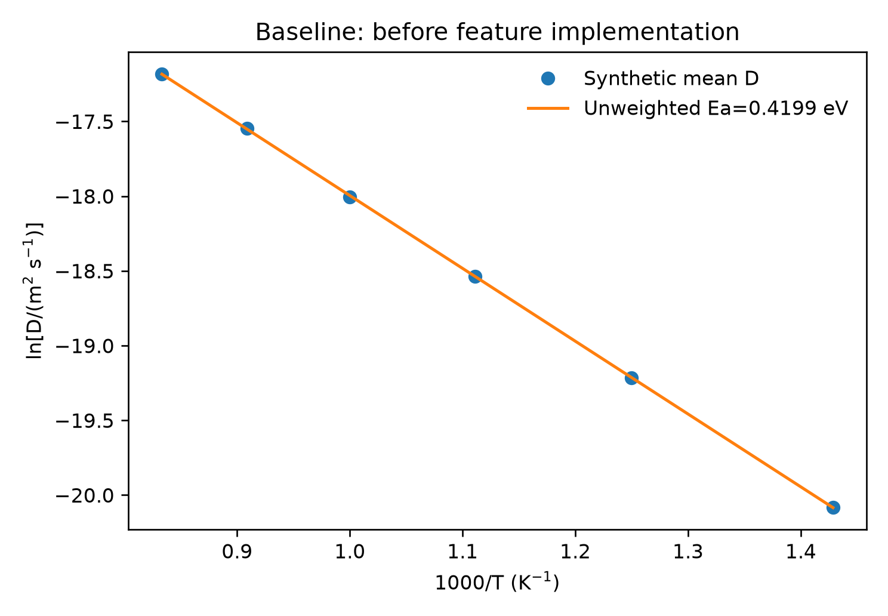
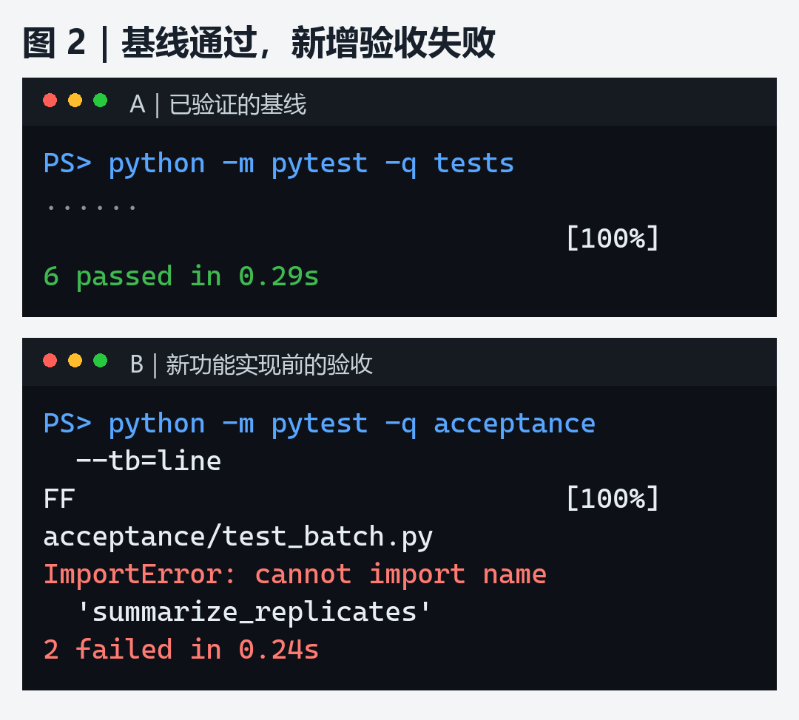
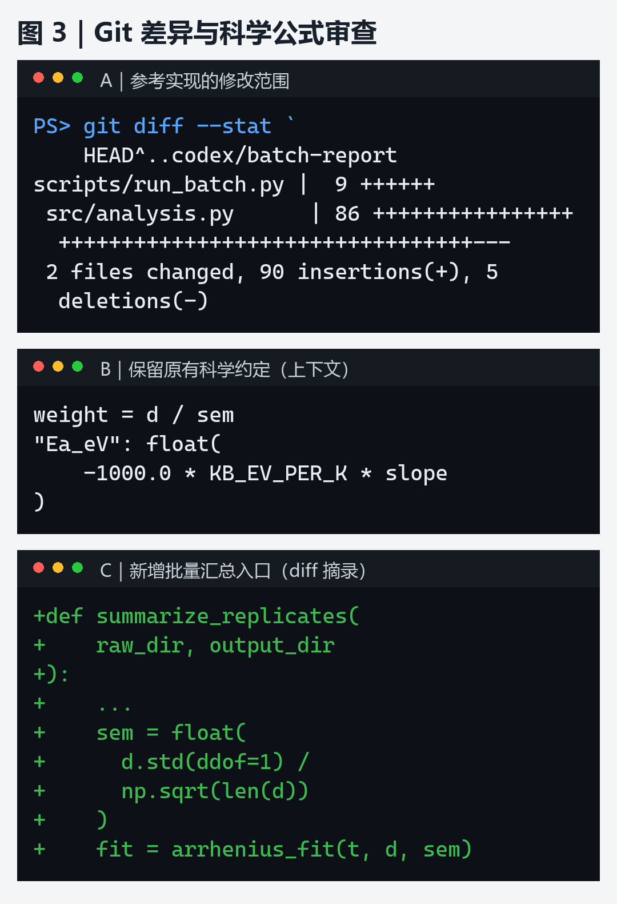
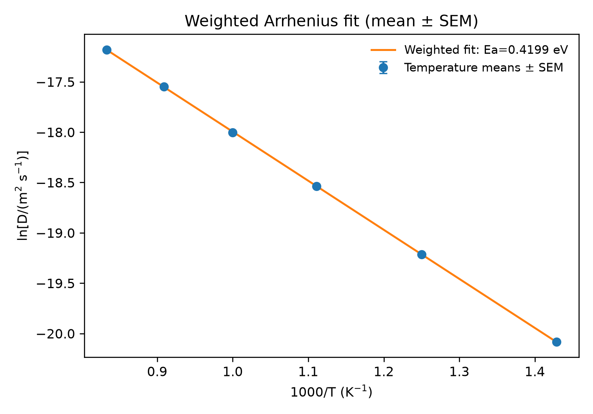
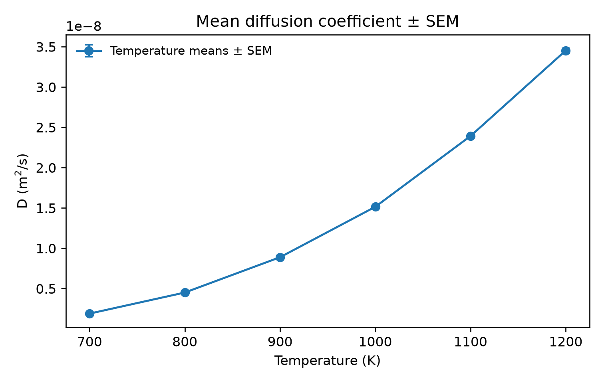
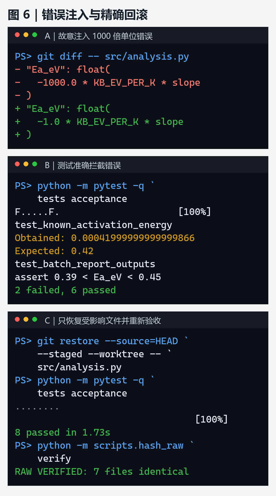

# Codex 科研实战（04）：Codex + Git，把 AI 的代码修改关进可回滚的实验工作区

> **从真实的 `git worktree` 实验出发：原始数据不入库、AI 在独立分支工作、自动检查修改范围、用 pytest 验收科学结果，出现错误只撤销受影响的代码。**
>
> **Codex 科研实战系列 · 第 04/18 期**

## 写在前面：这次不讲 Git 概念，直接完成一次可撤销的科研功能开发

第三期我们已经从多温度扩散数据中提取了激活能。现在假设要让 Codex 给已有 Python 工具增加一个功能：**自动读取每个温度的独立重复，计算平均扩散系数和 SEM，进行加权 Arrhenius 拟合，并导出 CSV、JSON、PNG、PDF。**

如果直接在原始计算目录里让 Codex 修改代码，就很难区分哪些是原始数据、哪些是新输出；发生误改时也难以准确恢复。本期用一个可以实际运行的项目，建立以下验收链：

```text
已验证的 Git 主分支（baseline）
    │
    ├── 原始数据 raw_data/ （Git 不跟踪）
    │
    └── git worktree → 独立的 codex/batch-report 分支
                          │
                          ├── pytest：旧功能必须通过
                          ├── 新功能验收：先失败，再实现
                          ├── Codex 修改两份允许的代码文件
                          ├── git diff + 自动范围检查
                          ├── 原始数据 SHA-256 前后比对
                          └── pytest 全通过 → 人工审查 → checkpoint commit
```

这篇文章中，**Git 操作、基线测试、参考修改、数据完整性验证和错误回滚均已在本地执行**。Codex 的真实执行效果需要读者在本机登录后运行；不能把参考修改的结果当成 Codex 自动完成的结果。

---

# 01｜创建一个可以复现的科研 Git 项目

## 1.1 项目包含什么？

解压文末的配套项目包，进入 `project/`：

```text
project/
├── .gitignore
├── AGENTS.md
├── requirements.txt
├── src/
│   └── analysis.py             # 已验证的 Arrhenius 拟合
├── scripts/
│   ├── generate_demo.py       # 生成人工扩散数据
│   ├── plot_baseline.py       # 基线科研图
│   ├── hash_raw.py            # 原始数据 SHA-256 快照/校验
│   └── check_scope.py         # 代码修改范围审计
├── tests/
│   └── test_analysis.py       # 已有功能的回归测试
├── acceptance/
│   └── test_batch.py          # 待开发新功能的验收测试
├── raw_data/                  # 运行生成，Git 忽略
└── results/                   # 运行生成，Git 忽略
```

注意：本例使用的是**人工构造的扩散系数数据**，不包含真实 VASP、LAMMPS 或未发表的科研结果。这样可以放心演示错误修改与撤销。

安装依赖：

```bash
python -m pip install -r requirements.txt
```

生成演示数据并测试已有功能：

```bash
python -m scripts.generate_demo
python -m pytest -q tests
python -m scripts.plot_baseline
```

我实际运行得到：

```text
Generated 60 replicates in raw_data/
6 passed
Baseline Ea=0.419858 eV
```

数据共 6 个温度、每个温度 10 次独立重复，理论值设定为 $E_a=0.420\,\mathrm{eV}$，$D_0=2.0\times10^{-6}\,\mathrm{m^2/s}$。图像由 Python 根据这些数据绘制，不能当作真实 MD 模拟结果。



*图 1｜现有科研分析程序的基线 Arrhenius 拟合（人工构造的数据）。*

## 1.2 最关键的文件：`.gitignore`

项目内的 `.gitignore` 包含：

```gitignore
raw_data/
results/
.audit/
.venv/
__pycache__/
.pytest_cache/
*.pyc
.env
*.key
```

它的作用是**告诉 Git 不要把这些未跟踪文件纳入普通版本管理**，不是把文件设置为只读，也不是自动备份。

先初始化 Git，明确指定要提交的代码和测试：

```bash
git init -b main
git add .gitignore AGENTS.md README.md requirements.txt src tests acceptance scripts
git commit -m "baseline: verified diffusion fitting"
```

首次提交前，需要配置好 Git 的提交身份（`user.name` 和 `user.email`）。这里没有使用 `git add -A`，目的是明确选择版本化的代码文件。

现在检查原始数据是否被忽略：

```bash
git check-ignore -v raw_data/T700K/replicates.csv
git ls-files raw_data
```

本教程实测输出中，第一条显示匹配规则 `.gitignore:2:raw_data/`，第二条**没有任何输出**，说明原始数据没有进入 Git 索引。

**一个特别容易犯的错误：先提交了数据，后来才把它写进 `.gitignore`。** 已经被 Git 跟踪的文件不受 `.gitignore` 的新增规则影响。对于确实不该继续被跟踪的文件，可在核实后用 `git rm --cached` 将其从索引中移除，但旧提交仍可能包含历史副本；如果数据敏感，不能认为这个操作已经清除了历史泄露。

---


## 1.3 不仅要忽略文件，还要验证 Git 索引

新增 `.gitignore` 后，先检查规则是否生效：

```bash
git check-ignore -v raw_data/T700K/replicates.csv
git ls-files -- raw_data results .audit
```

第一条应显示匹配到的忽略规则；第二条在本教程基线中应为空。两条命令回答的是不同问题：**Git 应该忽略什么，以及 Git 目前实际跟踪了什么**。如果文件曾被提交，第二条仍会显示它，修改 `.gitignore` 并不能撤销历史提交。

还有一个值得刻意演示的操作：用一个临时文件检查 `git status` 是否会显示它。

```bash
python -c "from pathlib import Path; Path('raw_data/check_ignore.tmp').write_text('demo')"
git status --short
```

在忽略规则生效时，这个临时文件不会出现在普通 `git status` 中。实验结束后只删除**明确知道是刚才创建的** `raw_data/check_ignore.tmp`，不要批量清理 `raw_data/`。这也说明 `.gitignore` 的主要作用是防止误提交，**并不能防止代码覆盖或删除文件**。

跨平台删除这一个已知临时文件，可以二选一：

```bash
# macOS / Linux / Git Bash
rm -- raw_data/check_ignore.tmp
```

```powershell
# Windows PowerShell
Remove-Item -LiteralPath raw_data/check_ignore.tmp
```

# 02｜用 `git worktree` 给 Codex 单独开实验台

## 2.1 为什么不用直接在主目录开发？

普通 `git switch -c` 虽然可以切分支，但仍共享同一个工作目录中的未提交文件。而 `git worktree` 能让同一个仓库的不同分支分别有自己的工作目录：主目录保持基线，AI 在另一个目录开发。

在 `project/` 中执行：

```bash
git worktree add -b codex/batch-report ../codex-lab-04
```

然后进入新的工作目录：

```bash
cd ../codex-lab-04
```

这里的 `../codex-lab-04` 是独立工作区，包含已被 Git 跟踪的代码；**它不会自动复制原主目录中被忽略的 raw_data/**。这正是本期想利用的特性。

在这个工作区中重新生成**人工演示数据**：

```bash
python -m scripts.generate_demo
python -m scripts.hash_raw snapshot
```

当前 Git 分支可以通过以下命令检查：

```bash
git branch --show-current
git worktree list
```

如果你使用的是真实科研数据，**不要把原始 VASP/MD 目录作为 Codex 的工作区，也不要为了让 worktree 访问它而给 Codex 额外写权限**。可以使用脱敏且最小化的测试样本，或在外部受限环境中只读提供必要输入。Worktree 是开发隔离便利工具，并非安全沙盒；多个 worktree 仍共享 Git 对象库。

## 2.2 先让新增功能的测试失败

这个项目里 `tests/` 是原有程序的回归测试，`acceptance/` 是新增功能的验收测试。

先执行：

```bash
python -m pytest -q tests
```

本地基线为：

```text
6 passed
```

再执行：

```bash
python -m pytest -q acceptance
```

本地实际结果：

```text
2 failed
ImportError: cannot import name 'summarize_replicates'
```

失败是合理的，因为我们尚未实现 `summarize_replicates()`。测试要求它读取 `raw_data/T*/replicates.csv`，输出每温度的 `mean_D` 与 `SEM`、加权 Arrhenius 拟合结果及科研图，并比较函数返回前后原始输入的最终文件清单与字节内容。

这就是这次功能开发的**可检查边界**：已有功能保持通过，新功能从失败变成通过，且验收结束时的输入文件状态与事前快照一致。



*图 2｜根据本地真实 pytest 输出排版：原有回归测试全部通过，而新功能验收测试在实现前明确失败。*

---


## 2.3 验收测试究竟验证了什么？

配套项目里的 `acceptance/test_batch.py` 包含两项测试，它们不是“程序能启动”这种弱条件。

第一项 `test_batch_report_outputs()` 用临时目录承接结果，检查：

```python
summary = summarize_replicates(raw, tmp_path)
assert len(summary['rows']) == 6
assert 0.39 < summary['Ea_eV'] < 0.45
assert (tmp_path / 'temperature_summary.csv').is_file()
assert (tmp_path / 'arrhenius.png').is_file()
assert (tmp_path / 'arrhenius.pdf').is_file()
assert (tmp_path / 'analysis_summary.json').is_file()
assert (tmp_path / 'diffusion_vs_temperature.png').is_file()
```

它还读取 CSV，确认一共六个温度、每个温度有十次独立重复，而且 SEM 为正值。随后从汇总行重新构造 `T`、`mean(D)` 和 `SEM(D)`，将批处理返回的斜率、截距、$E_a$、$D_0$ 与显式调用 `arrhenius_fit(t, d, sem)` 的结果逐项比较，并确认它不同于未加权拟合。这样可以防止“底层函数支持权重，但批处理入口忘记传入 SEM”仍然蒙混过关。JSON 中必须保留标识 `synthetic_diffusion_replicates`，避免读者把人工数据误认为实验或 AIMD 数据。

第二项 `test_batch_read_only()` 则在函数调用前后，对原始目录逐文件计算 SHA-256：

```python
before = state()
summarize_replicates(raw, tmp_path)
assert before == state()
```

这里 `tmp_path` 是 pytest 提供的临时输出目录，用来把结果与原始输入分开，也避免测试之间因旧输出文件而相互干扰。测试还分别把 `output_dir` 设为 `raw_dir` 本身和它的子目录，要求函数在创建任何输出前抛出 `ValueError`，并再次核对哈希不变。上述断言证明的是**函数返回时**文件清单与字节内容恢复为相同状态；它不能单独证明运行期间绝对没有发生过短暂写入。

**设计验收测试的关键不是写更多断言，而是先将“结果可信”拆成可独立检查的条件。** 对本例来说，至少包括科学公式、输出格式、重复数量和输入最终状态一致性四项。

# 03｜让 Codex 修改代码，但先锁定修改范围

## 3.1 Codex 的任务指令

在 `codex-lab-04/` 目录启动 Codex：

```bash
codex --sandbox workspace-write --ask-for-approval on-request
```

将下面这段任务直接交给 Codex：

```text
请先阅读 AGENTS.md、src/analysis.py、tests/test_analysis.py
和 acceptance/test_batch.py。

已有科研拟合函数 arrhenius_fit() 必须保持兼容。

只允许修改或创建：
- src/analysis.py
- scripts/run_batch.py

新增函数：
summarize_replicates(raw_dir, output_dir)

功能要求：
1. 扫描 raw_dir/T{temperature}K/replicates.csv。
2. 对每个温度的独立重复计算 mean(D) 和 SEM(D)。
3. 使用 x=1000/T，y=ln(D)。
4. 采用 sigma_y≈SEM(D)/mean(D)，
   np.polyfit 的权重为 1/sigma_y。
5. Ea=-1000*kB*slope，单位 eV。
6. 只向 output_dir 写入：
   temperature_summary.csv、analysis_summary.json、
   arrhenius.png、arrhenius.pdf、
   diffusion_vs_temperature.png。
7. 缺失、非正或非有限 D 必须报错。
8. 不允许修改 raw_data/、tests/、acceptance/、.gitignore。
9. 不使用任何删除命令，不提交 Git。

执行以下验证：
python -m pytest -q tests acceptance
python -m scripts.hash_raw verify
python -m scripts.check_scope

最后逐项报告测试结果、修改文件和未解决的问题。
```

这条任务不是让 AI 自由重构整个项目，而是让它完成一个**能够通过独立测试的新功能**。

如果希望使用非交互接口，Codex CLI 也支持 `codex exec`。但本期涉及审查文件修改，因此更推荐先用交互模式保留人工审批，不要在真实科研目录中为了省事关闭审批或放宽沙盒。

## 3.2 看 `git diff`，而不只是看 Codex 的解释

Codex 修改后，不要马上 `git add`。

先运行：

```bash
git status --short
git diff --check
git diff -- src/analysis.py
```

如果 Codex 新建了 `scripts/run_batch.py`，默认 `git diff` 不会显示未跟踪文件的内容。可以先查看文件，或者在确认路径后执行：

```bash
git add -N scripts/run_batch.py
git diff -- src/analysis.py scripts/run_batch.py
```

`git add -N` 只将路径记为“意图加入索引”，便于 diff 展示；它**不等于正式暂存文件的全部内容**。



*图 3｜根据本地实际 Git diff 排版：审查待合并的科研代码，而不是只接受模型的文字总结。*

## 3.3 自动检查哪些文件被修改

本期还提供一个额外的代码审计脚本：

```bash
python -m scripts.check_scope
```

核心检查逻辑是：

```python
ALLOWED = {'src/analysis.py', 'scripts/run_batch.py'}

tracked_changes = set(
    git('diff', '--no-renames', '--name-only', 'HEAD', '--')
)

untracked_changes = set(
    git('ls-files', '--others', '--exclude-standard')
)

unexpected = (tracked_changes | untracked_changes) - ALLOWED

if unexpected:
    raise SystemExit(f'FAIL: out-of-scope changes: {sorted(unexpected)}')
```

这里检查两种变化：已跟踪文件的差异，以及 Git 尚未跟踪的新文件。`--no-renames` 让重命名不会隐藏原路径的删除与新路径的新增。

实际参考实现的运行结果：

```text
SCOPE PASS: scripts/run_batch.py, src/analysis.py
RAW UNTRACKED: no raw_data, results or audit files in git index
```

它属于**事后检查**，不能阻止程序在执行时接触或修改其他文件；高风险项目还需要系统级只读权限或容器隔离。

## 3.4 独立检查原始数据的最终内容状态

基线时执行过：

```bash
python -m scripts.hash_raw snapshot
```

这个脚本会对 `raw_data/` 下的每个文件计算 SHA-256，保存到被 Git 忽略的 `.audit/raw_manifest.json`。代码修改和验收结束后执行：

```bash
python -m scripts.hash_raw verify
```

参考实现的实际输出为：

```text
RAW VERIFIED: 7 files identical
```

这 7 个文件包括 6 份温度数据和一个 metadata 文件。该结果表明**校验时刻**的文件集合与字节内容和快照一致；比较同时检查文件新增与删除，而不仅是已存在文件的内容修改。

SHA-256 是很有用的最终内容状态检查，但它既不能阻止事前误删，也不能证明运行期间从未短暂写入后又恢复，更不等于数据备份。因此，真正的原始轨迹还需要独立备份、系统级只读权限或受限环境。

---


## 3.5 两个可以直接复用的审计脚本

**原始数据最终内容状态检查**的核心是把文件相对路径映射到 SHA-256。这样既能发现校验时内容与快照不一致，也能发现文件集合的新增或删除：

```python
from pathlib import Path
import hashlib

RAW = Path('raw_data')

def inventory():
    return {
        str(p.relative_to(RAW)): hashlib.sha256(p.read_bytes()).hexdigest()
        for p in RAW.rglob('*')
        if p.is_file()
    }

# 修改前把 inventory() 保存到 .audit/raw_manifest.json
# 修改后读取记录，和新的 inventory() 作完整字典比较
```

项目已提供可运行的 `scripts/hash_raw.py`，因此读者无需手动复制这段简化实现。本期用下面的前后比较检查最终状态：

```bash
python -m scripts.hash_raw snapshot
# 让 Codex 修改分析代码
python -m scripts.hash_raw verify
```

**代码修改范围检查**则不应只查看 `git diff --name-only`，因为新建的未跟踪文件可能被遗漏。本期脚本同时收集：

```python
tracked = set(git('diff', '--no-renames', '--name-only', 'HEAD', '--'))
untracked = set(git('ls-files', '--others', '--exclude-standard'))
modified = tracked | untracked
unexpected = modified - {'src/analysis.py', 'scripts/run_batch.py'}
if unexpected:
    raise SystemExit(f'Out-of-scope: {sorted(unexpected)}')
```

完整脚本还额外检查原始数据、结果和审计目录是否错误进入 Git 索引。执行后必须人工再看一次 `git diff`，因为“只修改了允许的文件”并不意味着“修改内容正确”。

这里有一个边界需要明确：**Git 审计不能作为保密数据的安全隔离**。如果使用真实未发表数据，应该在 Codex 工作区外保留原始目录，并通过权限或受限环境控制访问，而不是仅依赖提示词。

# 04｜科学验收：看真实结果，不只看 Git 干不干净

## 4.1 实际测试结果

本期我在独立 worktree 中应用了**人工准备的参考实现**，然后执行：

如果本机暂时不能使用 Codex，配套包提供 `reference/reference_feature.patch` 作为独立的教学答案。在**未做过任何功能修改且工作区干净**的 `codex-lab-04/` 中，可先检查补丁再应用：

```bash
git apply --check ../reference/reference_feature.patch
git apply ../reference/reference_feature.patch
```

之后再运行下面的验收命令。**补丁复现的结果只能记作参考实现，不能写成 Codex 自动生成的结果。**

```bash
python -m pytest -q tests acceptance
python -m scripts.run_batch
python -m scripts.hash_raw verify
python -m scripts.check_scope
```

实际运行结果：

```text
8 passed
BATCH VERIFIED Ea_eV=0.419902 n_T=6
RAW VERIFIED: 7 files identical
SCOPE PASS: scripts/run_batch.py, src/analysis.py
```

这里的 8 项测试包括原有的 6 项回归测试，以及新增的 2 项功能验收。**这是参考代码的本地验证，不是声称 Codex 已经自主完成了这次修改。**

在进入后面的故意破坏实验前，必须先把这个已通过验收的功能版本保存为 checkpoint。先人工审查差异，再只提交允许的两个文件：

```bash
git diff --check
git diff -- src/analysis.py scripts/run_batch.py
git add src/analysis.py scripts/run_batch.py
git diff --cached --check
git diff --cached -- src/analysis.py scripts/run_batch.py
git commit -m "feat: audited batch Arrhenius report"
git status --short
```

`git status --short` 此时应无输出。这个 checkpoint 让 `HEAD` 指向已验证的新功能；后面的 `git restore --source=HEAD` 才会撤销故意注入的错误，而不是把整个新功能一起退回基线。被 `.gitignore` 排除的 `raw_data/`、`results/` 和 `.audit/` 不应进入这次提交。

修复版输出的主要数值是：

| 指标 | 参考实现运行结果 |
|---|---:|
| 设定真值 $E_a$ | 0.420000 eV |
| 加权拟合 $E_a$ | **0.419902 eV** |
| 拟合 $D_0$ | $1.999319\times10^{-6}$ m²/s |
| 未加权 R²（描述值） | 0.999976 |
| 校验时的输入最终状态 | 7/7 文件 SHA-256 与清单一致 |

## 4.2 导出的图与表

工作区运行后生成：

```text
results/
├── temperature_summary.csv
├── analysis_summary.json
├── arrhenius.png
├── arrhenius.pdf
└── diffusion_vs_temperature.png
```

原有脚本还可生成 `fig01_baseline_arrhenius.png`，用于与新增的加权拟合相比较。



*图 4｜独立重复均值和 SEM 加权的 Arrhenius 拟合，数据为人工构造的扩散演示数据。*



*图 5｜六个温度下的独立重复扩散系数均值与 SEM。*

这次验收要求不仅是 Python 无异常，还包括：拟合得到的 $E_a$ 接近设定真值、加权方式正确、CSV 与 JSON 可读、原始输入的最终文件状态与快照一致，并且新旧功能测试都通过。

---


## 4.3 核对加权拟合的物理定义

验收能量数据时，最容易被忽略的是权重约定。假设每个温度有 $n$ 次**独立**的扩散系数测量：

$$
\overline{D}=\frac{1}{n}\sum_{i=1}^{n}D_i,\qquad
\mathrm{SEM}(D)=\frac{\mathrm{SD}(D_i)}{\sqrt{n}}.
$$

本例采用 $x=1000/T$ 和 $y=\ln\overline{D}$。在相对误差较小时，一阶误差传播给出 $\sigma_y\approx\mathrm{SEM}(D)/\overline{D}$。NumPy `polyfit` 的 `w` 是残差权重，所以取：

```python
x = 1000.0 / temperature_K
y = np.log(mean_D_m2_s)
sigma_y = sem_D_m2_s / mean_D_m2_s
slope, intercept = np.polyfit(x, y, 1, w=1.0 / sigma_y)
Ea_eV = -1000.0 * KB_EV_PER_K * slope
D0_m2_s = np.exp(intercept)
```

这几行是人工审查重点，而不是单纯检查 `pytest` 变成绿色。因为 `Ea`、`D0`、单位和误差棒定义必须在程序、CSV、JSON 和图注里保持一致。当前演示数据并不代表真实 MD 的扩散抽样性质，尤其不能把一条轨迹上的连续时间点视为独立重复。

对实际材料模拟，还应该额外检查：输入是否存在跨温度单位差异、低温 MSD 是否进入线性区、单次模拟的统计不确定度是否可靠，以及不同温度是否可能存在扩散机制改变。

# 05｜一次真正的撤销实验：故意破坏公式，再精确恢复

这一部分是本期最重要的 Git 操作。假设 Codex 修改之后，发现激活能公式被错误改成：

```diff
- "Ea_eV": float(-1000.0 * KB_EV_PER_K * slope),
+ "Ea_eV": float(-1.0 * KB_EV_PER_K * slope),
```

如果只看图，拟合线、R² 仍然可能正常，但 $E_a$ 会小 1000 倍。

为了验证 Git 能否帮助我们准确回到安全版本，我在上一节的功能 checkpoint 提交后**手工注入了上述错误**。此时 `HEAD` 已经包含 `summarize_replicates()` 的完整实现，错误只存在于尚未提交的工作区。再运行：

```bash
python -m pytest -q tests acceptance
```

得到真实结果：

```text
2 failed, 6 passed
```

说明已有的解析测试和批量验收测试都发现了错误。

这次错误还没有提交，所以可以只恢复受影响的文件：

```bash
git diff -- src/analysis.py
git restore --source=HEAD --staged --worktree -- src/analysis.py
```

再运行：

```bash
python -m pytest -q tests acceptance
python -m scripts.hash_raw verify
```

实际结果恢复为：

```text
8 passed
RAW VERIFIED: 7 files identical
```



*图 6｜根据本地实际 diff 与测试日志排版：注入错误公式后测试失败，使用 Git 精确恢复目标代码，再次通过科学验收。*

这里需要区分三种操作：

| 情况 | 常用方式 | 说明 |
|---|---|---|
| 改错但尚未提交 | `git restore --source=HEAD --staged --worktree -- 文件` | 丢弃该路径未提交修改，执行前先审查是否有需要保留的工作 |
| 变更已经提交且需要保留历史 | `git revert <commit>` | 通过新提交撤销旧提交所引入的变化 |
| 只想查看历史文件 | `git show <commit>:路径` | 不修改当前工作区 |

不推荐初学者在重要科研目录里直接运行 `git reset --hard` 或 `git clean -fdx`。尤其 `git clean -fdx` 可能删除被 `.gitignore` 排除的原始数据和计算输出，Git 也不会自动帮你恢复这些未被跟踪的文件。

本期使用了**精确到单个文件的恢复**，而不是把整个工作区重置掉。

---


## 5.1 如果文件里还有别的未提交修改，如何只撤销错误的一小块？

前面的 `git restore --source=HEAD --staged --worktree -- src/analysis.py` 会丢弃**整个文件**中尚未提交的变化。如果同一个文件里还有需要保留的新功能，不能直接执行。

此时可以先用交互式补丁恢复：

```bash
git diff -- src/analysis.py
git restore -p --source=HEAD -- src/analysis.py
```

Git 会逐块询问是否恢复；只选择包含错误斜率系数的那个 hunk。每次确认前，都要认真查看显示的修改块。如果多个变化挤在同一个 hunk 中，应先保存补丁或手工编辑，不要依赖交互模式自动区分科研语义。

更稳妥的习惯是：**一个清晰、经过测试的功能完成后就创建一个小提交**。这样发现问题时，恢复目标和撤销范围会更明确。

# 06｜审查已提交的 AI 修改，再并入主分支

第 4 节已经把通过验收的功能保存成 checkpoint，因此这里**不要重复 `git add` 和 `git commit`**。先确认故意注入的错误已撤销、工作区干净，再审查已提交的差异：

```bash
python -m pytest -q tests acceptance
python -m scripts.hash_raw verify
python -m scripts.check_scope
git status --short
git log -1 --oneline
git diff --check HEAD^ HEAD
git diff HEAD^ HEAD -- src/analysis.py scripts/run_batch.py
```

正常情况下，`git status --short` 应无输出。还需要确认该提交中 `scripts/run_batch.py` 的完整内容、函数接口和异常处理已经由人审查。

此时主分支不会因为 AI worktree 中的提交而自动更新。先留在当前 Codex worktree 中审查分支历史和待合并差异：

```bash
git log --oneline --graph --all --max-count=5
git diff main..codex/batch-report -- src/analysis.py scripts/run_batch.py
```

确认无误后再选择合并方式。不要把“测试通过”直接等同于“可以无条件合并”，因为真实材料项目还涉及计算参数、原子模型和科学假设的审查。

在我们本地演示的 Git 历史中，实际出现了两个提交：**已验证的基线版本**和**通过验收的批量分析功能版本**。没有真实 Codex 修复日志，因此本文不会伪造 Codex 的提交轨迹。

---


## 6.1 从实验分支合并回 main 的完整闭环

功能提交之后，回到主 worktree：

```bash
cd ../project
git status --short
git diff --stat main..codex/batch-report
git log --oneline --graph --all --max-count=6
```

确认主目录没有需要保留的未提交修改，再审查差异：

```bash
git diff main..codex/batch-report -- src/analysis.py scripts/run_batch.py
```

正式合并（会修改主分支，**只有审查通过后才执行**）：

```bash
git merge --no-ff codex/batch-report -m "merge: audited batch Arrhenius report"
python -m scripts.generate_demo
python -m scripts.hash_raw snapshot
python -m pytest -q tests acceptance
python -m scripts.hash_raw verify
```

这里重新生成的是本期可复现的**人工演示数据**；如果项目是正式科研数据，禁止使用生成脚本覆盖原始目录，应改为读取受保护数据或小型只读样例，并沿用之前的独立完整性清单。

如果只想把独立分支保留为候选成果，完全可以暂不合并。通过 `git worktree list` 找到开发目录，在提交和备份已完成、工作区干净时再执行 `git worktree remove`。不要用强制删除来清理有未保存结果的 worktree。

最终 Git 提交记录可以说明**是哪一次变更引入了功能**；测试日志与原始数据的前后哈希则说明**为什么认为这个版本在验收结束时通过了当前科学检查**。这两类证据缺一不可。

# 本期总结

这次使用 Git，不只是为了保存代码历史，而是把一次 AI 科研编程任务变成了完整的可审查实验：

**创建基线 → 生成独立 worktree → 先观察验收失败 → 修改限定文件 → 检查 diff → 运行科学测试 → 比对数据哈希 → 建立 checkpoint 提交 → 精确撤销未提交错误。**

本期真实验证：原功能 **6 passed**；待开发功能最初 **2 failed**；应用参考功能后 **8 passed**；建立功能 checkpoint 后手工注入错误，得到 **2 failed、6 passed**；精确回滚后再次 **8 passed**。同时，7 份原始演示文件在前后校验时的 SHA-256 与文件清单一致；这是最终状态验证，不是对运行期间绝对只读的证明。

对于 VASP、LAMMPS、NEB 和机器学习势函数项目，最有价值的是这套“**代码可回滚、数据不被顺手改、数值可独立复验**”的开发方式，而不是盲目让 Codex 修改更多文件。

---

# 下期预告

**Codex 科研实战（05）：让 Codex 自动定位 Python 报错——从 traceback、最小复现到回归测试**。

下一期将更深入讨论科学 Python 程序中的异常处理、报错定位、回归测试设计，以及如何处理多种错误叠加的问题。

---

# 参考资料与致谢

本文操作细节参考以下官方资料，科学数据、测试、代码与图表为本系列针对教学独立构造的示例：

1. Git — gitignore：https://git-scm.com/docs/gitignore
2. Git — git-worktree：https://git-scm.com/docs/git-worktree
3. Git — git-restore：https://git-scm.com/docs/git-restore
4. Git — git-revert：https://git-scm.com/docs/git-revert
5. OpenAI — Codex CLI Reference：https://developers.openai.com/codex/cli/reference
6. OpenAI — AGENTS.md：https://developers.openai.com/codex/guides/agents-md
7. pytest：https://docs.pytest.org/
8. NumPy — polyfit：https://numpy.org/doc/stable/reference/generated/numpy.polyfit.html

**Codex 科研实战｜第 04 期 完**
