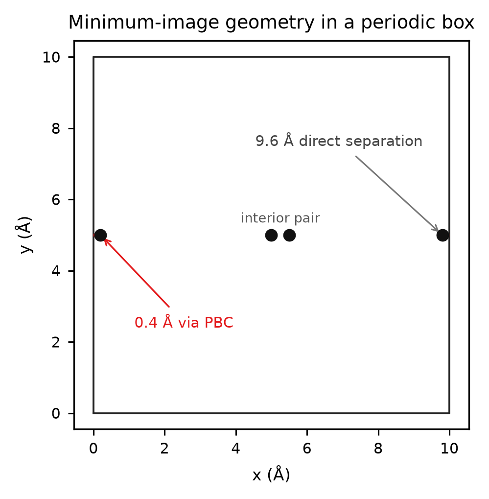
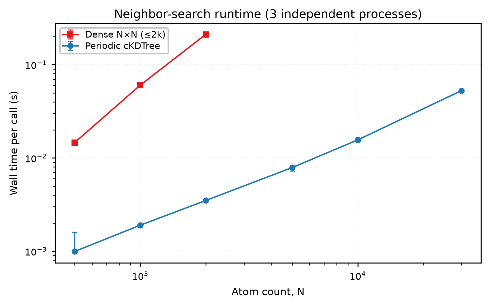
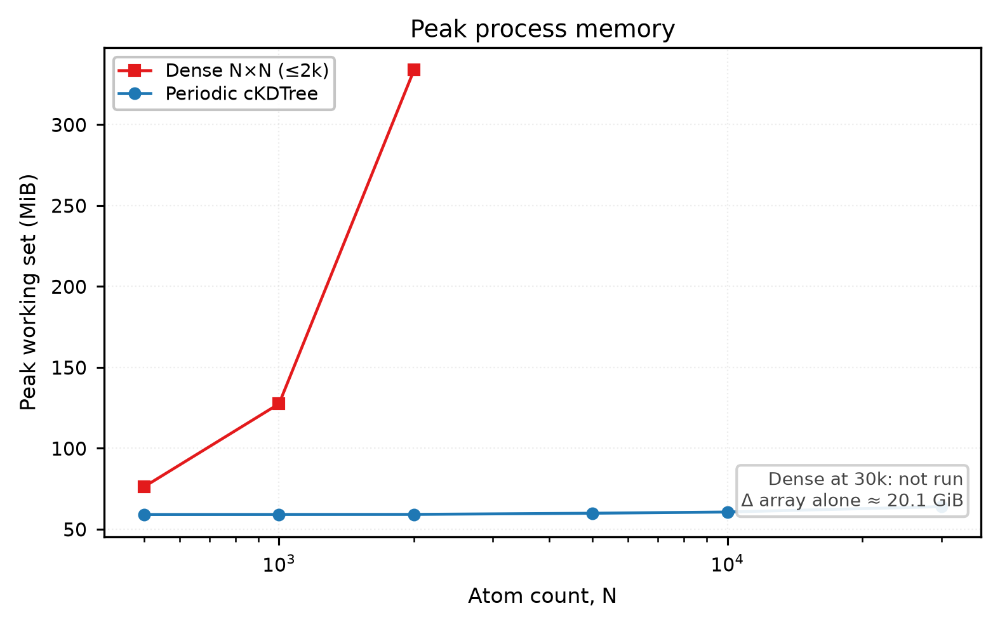
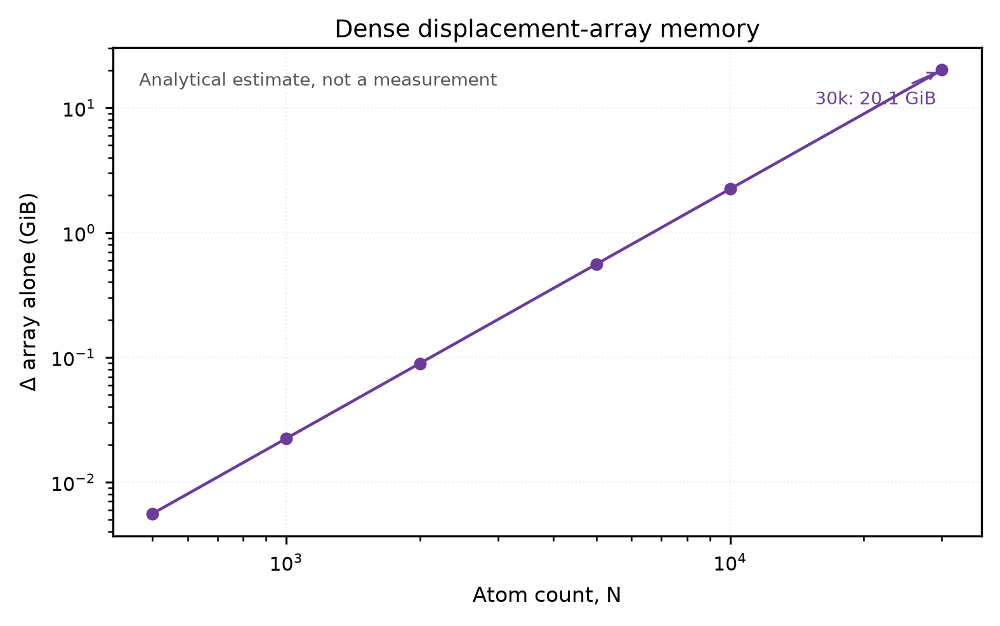
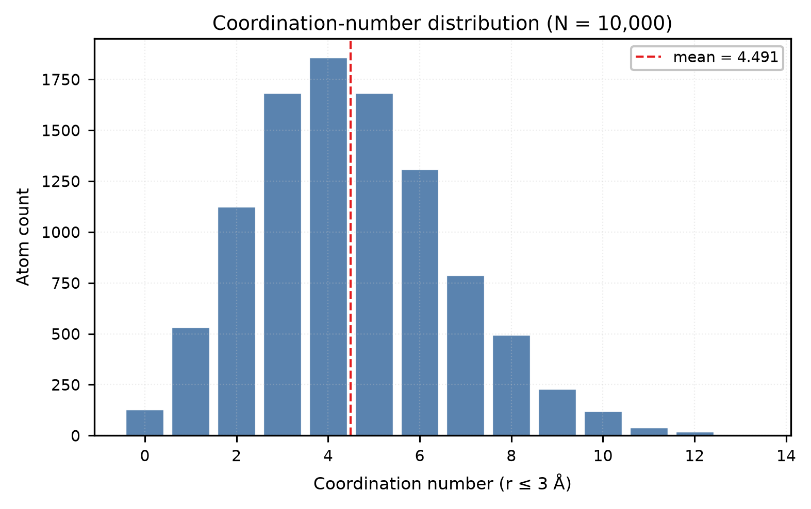
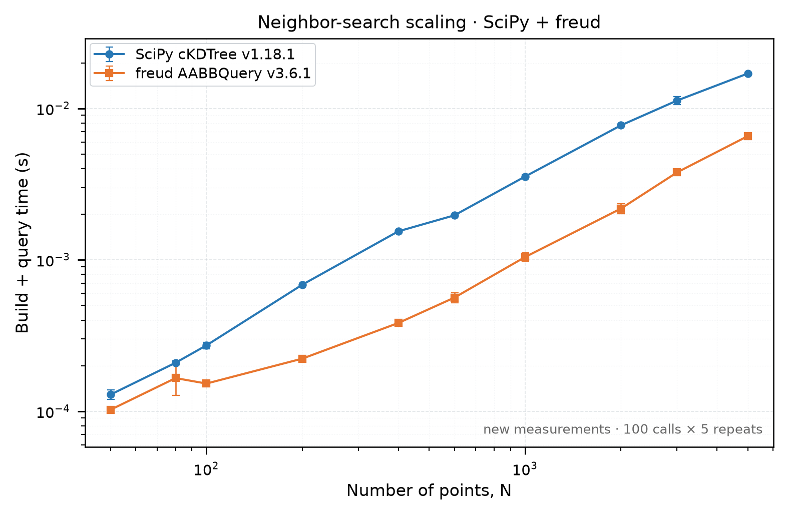
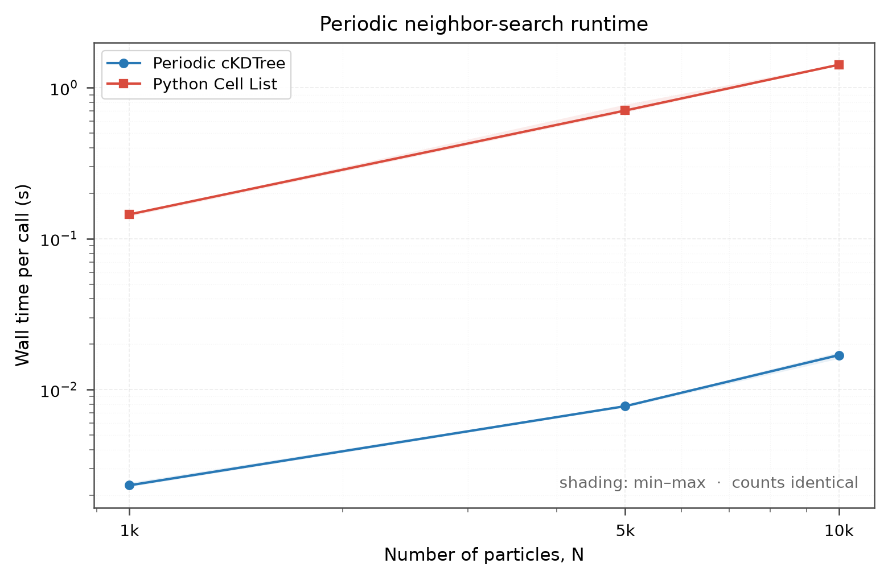

# Codex 科研实战（05）：3 万原子配位分析性能优化——从 cKDTree 到 freud（2020）Figure 3 方法学复现

> **从一个会分配 20 GiB 内存的 NumPy 程序出发，利用 Codex 辅助理解性能瓶颈，再用空间索引重构；最后用物理等价性测试、独立进程 Benchmark 验证优化，并完成 SciPy + freud 双分支的 Figure 3 方法学复现。**
>
> Codex 科研实战系列 · 第 05/18 期

## 写在前面：这次不重复“报错 → pytest → 修复”

上一期我们用 Git worktree 审计和回滚 AI 对科研代码的修改。第五期换一个实际的工程问题：**给定三维周期晶胞中数万原子的坐标，统计截断距离内的配位数（coordination number）**。

最直观的代码会构造 `(N, N, 3)` 的全原子位移张量。对于 30,000 个原子，仅这个 `float64` 张量的理论空间就达到 **21.6 GB（约 20.1 GiB）**，后续距离平方、布尔矩阵和临时复制还需要更多内存。它没有语法错误，也未必有物理公式错误，却不适合真实规模。

本期做一条新的技术路线：

```text
NumPy 全距离矩阵（O(N²)）
             ↓
cProfile 定位耗时函数
             ↓
周期性 cKDTree + 稀疏原子对
             ↓
最小镜像/PBC/置换不变性测试
             ↓
独立进程计时 + 进程峰值 RSS
             ↓
性能图 + 配位数分布 + Cell List 对照
             ↓
freud（2020）Figure 3 双分支方法学复现
```

这里的数据是**确定随机种子的均匀分布粒子**，只用于算法与周期性边界测试，不是任何真实材料的原子轨迹。本次在 Windows 11、Python 3.13.1、NumPy 2.5.5、SciPy 1.18.1、freud 3.6.1 环境中重新执行；正文仍**不把参考代码的形成过程伪装成 Codex 的历史运行日志**。

> **本次可核验交付状态**
>
> 配套项目已包含源码、28 项测试、独立进程原始记录、CSV/JSON、profiling 文件、7 组 PNG/PDF 和完整 ZIP。所有表格均来自随机种子 `20261116` 的本机最终运行；30,000 粒子的 Dense 内存仍只做解析推算，不冒险执行会导致内存耗尽的路径。

---

# 01｜从一个 O(N²) 的 NumPy 写法开始

## 1.1 研究任务和边界条件

我们定义每个原子 $i$ 的配位数为：

$$
CN_i=\sum_{j\ne i}\mathbf{1}\big(d_{ij}^{\mathrm{MIC}}\le r_c\big).
$$

其中 $r_c=3.0$ Å 是本例的截断半径，$d_{ij}^{\mathrm{MIC}}$ 是三维周期性边界下的最小镜像距离；自配对 $i=j$ 必须排除，而相同坐标的两个**不同**原子仍可彼此计数。

本次刻意将问题限定在**三个方向均周期的正交晶胞**：晶胞由 $(L_x,L_y,L_z)$ 表示，坐标单位是 Å，且要求 $0<r_c<\min(L_x,L_y,L_z)/2$。这是一项保守的示例约束，避免跨越半个晶胞带来的最小镜像歧义，不意味着任意更大 cutoff 的科学问题都不合法。

最小镜像位移可写成：

$$
\Delta\mathbf r_{ij}^{\mathrm{MIC}}=\Delta\mathbf r_{ij}-\mathbf L\odot\operatorname{rint}(\Delta\mathbf r_{ij}/\mathbf L).
$$

这里 $\odot$ 表示逐分量相乘。

## 1.2 初始的全距离矩阵

```python
xyz = positions[:, None, :] - positions[None, :, :]
xyz -= box * np.rint(xyz / box)
dist2 = np.einsum('ijk,ijk->ij', xyz, xyz)
inside = dist2 <= cutoff**2
np.fill_diagonal(inside, False)
coordination = np.count_nonzero(inside, axis=1)
```

这个写法易理解，适合**小样本参考答案**，但第一行构造的是 `N×N×3` 张量，时间和内存都会随 $N^2$ 增长。以 30,000 原子为例：

$$
30{,}000^2\times3\times8=21.6\times10^9\ \text{bytes}=20.1\ \text{GiB}.
$$

这是**理论数组大小**，不是实际对 30,000 原子跑过的内存测量。为避免把机器耗尽，本期脚本明确禁止在大于 2,500 原子时运行该全距离矩阵实现。

## 1.3 用周期性 cKDTree 重构

SciPy 的 `cKDTree` 支持 `boxsize` 定义沿坐标轴的周期盒，并用 `query_pairs(cutoff, output_type='ndarray')` 返回截断半径内的不同原子对 $(i,j)$，不必构造完整距离矩阵。

```python
xyz = positions % box
pairs = cKDTree(xyz, boxsize=box).query_pairs(
    cutoff, eps=0.0, output_type='ndarray'
)
counts = np.bincount(pairs.ravel(), minlength=len(xyz))
```

每个 $(i,j)$ 都应给 $CN_i$ 和 $CN_j$ 各贡献 1，因此 `pairs.ravel()` 后调用 `np.bincount` 就能完成计数。最关键的是 `boxsize`、坐标 wrap、cutoff 的物理定义和输入单元检查：**优化代码速度之前，必须保证两种方法计算的是同一个科学量**。

下面是本教程经过实际测试的完整核心实现；`counts_dense()` 专门作为小规模真值对照，`counts_kdtree()` 用于大规模分析。

**核心实现节选：`src/neighbors.py`（完整文件见附件）**

```python
"""Coordination numbers in a fully periodic orthorhombic simulation box.

Explicit limitations: orthorhombic box only; one global cutoff; all 3 dimensions
periodic; count all other atoms, including coincident but distinct atoms.
"""
from __future__ import annotations

import numpy as np
from scipy.spatial import cKDTree


def validate(positions, box, cutoff):
    xyz = np.asarray(positions, dtype=np.float64)
    L = np.asarray(box, dtype=np.float64)
    if xyz.ndim != 2 or xyz.shape[1] != 3:
        raise ValueError("positions must have shape (N,3)")
    if L.shape != (3,) or not np.all(np.isfinite(L)) or np.any(L <= 0):
        raise ValueError("box must be three positive finite lengths")
    if not np.all(np.isfinite(xyz)):
        raise ValueError("positions must be finite")
    r = float(cutoff)
    if not np.isfinite(r) or r <= 0 or r >= 0.5 * np.min(L):
        raise ValueError("cutoff must satisfy 0 < cutoff < min(box)/2")
    return xyz % L, L, r


def counts_dense(positions, box, cutoff):
    """O(N^2) memory reference, only run for small test configurations."""
    xyz, L, r = validate(positions, box, cutoff)
    n = len(xyz)
    if not n:
        return np.zeros(0, dtype=np.int64)
    if n > 2500:
        raise ValueError("dense reference capped at 2500 atoms to prevent OOM")
    # Building (N,N,3) is intentional for demonstrating memory blowup.
    delta = xyz[:, None, :] - xyz[None, :, :]
    delta -= L * np.rint(delta / L)
    dist2 = np.einsum("ijk,ijk->ij", delta, delta)
    within = dist2 <= r**2
    np.fill_diagonal(within, False)
    return np.count_nonzero(within, axis=1).astype(np.int64)


def counts_kdtree(positions, box, cutoff):
    """Periodic cKDTree exact pair search; returned pairs use O(E) storage."""
    xyz, L, r = validate(positions, box, cutoff)
    n = len(xyz)
    if not n:
        return np.zeros(0, dtype=np.int64)
    tree = cKDTree(xyz, boxsize=L)
    pairs = tree.query_pairs(r, eps=0.0, output_type="ndarray")
    if pairs.size == 0:
        return np.zeros(n, dtype=np.int64)
    # Every pair contributes one neighbor to both endpoints.
    return np.bincount(pairs.ravel(), minlength=n).astype(np.int64)


def generate_positions(n, number_density=0.04, seed=20261116):
    """Deterministic uniform-particle benchmark, not a crystalline MD trajectory."""
    if not isinstance(n, int) or n < 0:
        raise ValueError("n must be nonnegative integer")
    if not np.isfinite(number_density) or number_density <= 0:
        raise ValueError("number_density must be positive finite")
    if n == 0:
        L = np.full(3, 20.0)
    else:
        L = np.full(3, (n / number_density)**(1 / 3))
    rng = np.random.default_rng(seed)
    return rng.random((n, 3)) * L, L
```

---

# 02｜先验证 PBC 和物理等价性，而不是先跑速度

## 2.1 一个跨晶胞边界的测试

设盒长 10 Å，有两个原子分别位于 $x=0.2$ Å 和 $x=9.8$ Å，且其他两个坐标相同。普通欧氏距离是 9.6 Å，但周期最小镜像距离是 **0.4 Å**。对于 $r_c=0.6$ Å，这对原子必须被统计为邻居。

如果优化程序忘记 `boxsize`，这项测试就会失败。其它重要测试还包括：

- 同一批原子无论怎样排列顺序，输出配位数应按同样顺序重排；
- 将原子整体平移整数个晶胞，配位数应保持不变；
- 自己不能算自己的邻居，但坐标完全重合的**两个不同原子**可以相互计数；
- 两个算法在小样本、相同 cutoff 和 PBC 下的配位数必须逐元素一致；
- 盒长、cutoff、非有限坐标不合法时必须明确失败；
- 大体系不得误入密集全距离矩阵路径。

## 2.2 17 项核心测试，完整项目共 28 项

下面展示核心测试节选；完整、已实际执行的版本见附件 `tests/test_neighbors.py`：

**核心节选：`tests/test_neighbors.py`**

```python
import numpy as np
import pytest

from src.neighbors import counts_dense, counts_kdtree, generate_positions


def test_periodic_faces_are_neighbors():
    L = [10., 10., 10.]
    xyz = [[0.2, 5, 5], [9.8, 5, 5], [5, 5, 5], [5.5, 5, 5]]
    np.testing.assert_array_equal(counts_kdtree(xyz, L, 0.6), [1, 1, 1, 1])


@pytest.mark.parametrize("n,seed", [(25, 1), (70, 17), (150, 31), (500, 48)])
def test_tree_exactly_agrees_with_dense(n, seed):
    xyz, L = generate_positions(n, seed=seed)
    np.testing.assert_array_equal(counts_kdtree(xyz, L, 3.), counts_dense(xyz, L, 3.))


def test_translation_by_box_vector():
    xyz, L = generate_positions(100, seed=19)
    shifted = xyz + np.array([L[0], -2*L[1], 3*L[2]])
    np.testing.assert_array_equal(counts_kdtree(xyz, L, 3), counts_kdtree(shifted, L, 3))


def test_permutation_equivariance():
    xyz, L = generate_positions(100, seed=11)
    permutation = np.random.default_rng(18).permutation(len(xyz))
    original = counts_kdtree(xyz, L, 3)
    permuted = counts_kdtree(xyz[permutation], L, 3)
    np.testing.assert_array_equal(permuted, original[permutation])


def test_empty_and_singleton():
    assert counts_kdtree(np.empty((0, 3)), [10, 10, 10], 1).size == 0
    np.testing.assert_array_equal(counts_kdtree([[1,2,3]], [10,10,10], 1), [0])


def test_duplicate_positions_are_distinct_atoms():
    xyz = [[1, 1, 1], [1, 1, 1]]
    np.testing.assert_array_equal(counts_kdtree(xyz, [10,10,10], 1), [1,1])


def test_at_cutoff_is_included():
    xyz = [[1,1,1], [1.5,1,1]]
    np.testing.assert_array_equal(counts_kdtree(xyz, [10,10,10], 0.5), [1,1])


@pytest.mark.parametrize("box,cutoff", [([10,10,10], 5), ([10,10,10], -1), ([0,10,10], 1), ([10,10], 1)])
def test_invalid_geometry_rejected(box, cutoff):
    with pytest.raises(ValueError):
        counts_kdtree([[1,1,1]], box, cutoff)


def test_nonfinite_positions_rejected():
    with pytest.raises(ValueError):
        counts_kdtree([[0, np.nan, 0]], [10,10,10], 1)


def test_atom_count_conservation():
    xyz, L = generate_positions(400, seed=6)
    counts = counts_kdtree(xyz, L, 3)
    # 2*E should be even and every pair contributes to two atoms.
    assert int(counts.sum()) % 2 == 0
    assert len(counts) == len(xyz)
    assert counts.min() >= 0


def test_dense_safety_cap():
    xyz, L = generate_positions(2501)
    with pytest.raises(ValueError, match="capped"):
        counts_dense(xyz, L, 3)
```

在项目根目录运行：

```bash
python -m pytest -q
```

本次从项目根目录实际运行的结果为（日志保存在 `results/pytest_output.txt`）：

```text
............................                                             [100%]
28 passed in 2.17s
```

这只能证明**上述数值与边界条件的已覆盖测试**通过；对倾斜晶胞、不同原子对截断、元素分组或特别高密度体系仍需扩展测试。

### 2.3 已核验测试状态

| 阶段 | 测试数量 | 本次状态 |
|---|---:|---|
| Dense 与周期 cKDTree 基础测试 | 17 | 已通过；覆盖 PBC、等价性、输入验证和 Dense 安全上限 |
| Cell List 扩展测试 | 8 | 已通过；逐粒子计数与周期 cKDTree 一致 |
| Figure 3 复现测试 | 3 | 已通过；覆盖盒长、查询口径和缺少 freud 时的透明失败 |
| **合计** | **28** | **28 passed** |



*图 1｜三维正交周期盒的二维教学投影：两个原子在图中相距 9.6 Å，但最小镜像距离为 0.4 Å。它是确定性几何示意，不是独立实验数据。*

---

# 03｜用 cProfile 找热点，用子进程 Benchmark 测时间与内存

## 3.1 先做性能诊断

`cProfile` 能够记录 Python 函数调用开销，`pstats` 可以根据累计时间（cumulative time）排序。下面的脚本在 **相同的 N=2000 粒子数据** 上分别执行密集算法和周期 KDTree，并将可读结果保存为 TXT，原始 profile 保存为 `.prof`。

执行命令：

```bash
python -m scripts.profile_methods
```

本次最终运行的 profiling 快照为（完整统计见 `results/profile_summary.json` 和两个 `.prof/.txt` 文件）：

```text
Dense counts_dense: 0.226318 s under cProfile
KDTree counts_kdtree: 0.003928 s under cProfile
两者 mean coordination = 4.629，sum coordination = 9258
```

这只是 profiling 过程内的耗时快照，**不用于报告正式的性能加速倍数**。`cProfile` 会引入额外开销，尤其对执行很短的函数更明显。正式的 Benchmark 应单独运行，并使用重复测量的中位数。

`pstats` 的累计时间包含函数内部调用，适合找出哪个高层函数是性能热点。它并不能直接告诉我们具体的 NumPy 临时数组内存分配方式；内存需要另行测量或推导。

**核心节选：`scripts/profile_methods.py`（完整文件见附件）**

```python
"""Profile identical N=2000 configurations, save human-readable hotspot reports."""
import cProfile
import io
import pstats
from pathlib import Path
from src.neighbors import counts_dense, counts_kdtree, generate_positions

ROOT=Path(__file__).resolve().parents[1]
OUT=ROOT/'results'


def run():
    OUT.mkdir(exist_ok=True)
    xyz,L=generate_positions(2000)
    for name,func in [('dense',counts_dense), ('kdtree',counts_kdtree)]:
        profiler=cProfile.Profile()
        profiler.enable()
        result=func(xyz,L,3.0)
        profiler.disable()
        profiler.dump_stats(str(OUT/f'profile_{name}.prof'))
        text=io.StringIO()
        pstats.Stats(profiler,stream=text).strip_dirs().sort_stats(
            pstats.SortKey.CUMULATIVE).print_stats(15)
        (OUT/f'profile_{name}.txt').write_text(text.getvalue(),encoding='utf-8')
        print(name, 'mean coordination',round(float(result.mean()),3),
              'profile saved')


if __name__=='__main__':
    run()
```

## 3.2 不要在同一个 Python 进程里轮流测峰值 RSS

如果使用 `resource.getrusage(...).ru_maxrss`，得到的是**进程生命周期内的历史峰值**。假如先运行一次高内存密集算法，再测低内存 KDTree，第二种算法可能“继承”第一种算法留下的峰值，导致比较失真。

因此，本期为**每一个算法、每一个粒子数量、每一次重复**启动一个新的 Python 子进程；子进程只执行该次邻居搜索，然后输出 JSON。

在 Linux/macOS，读取资源统计中的最大 RSS；Windows 通过 `psutil` 获取系统报告的工作集峰值。本次公开的 MiB 数值来自 **Windows 11 的峰值工作集**，其中包含 Python 解释器和已加载库；不同操作系统对高水位内存的定义可能不同，因此不要跨平台直接比较绝对值。

单次测试程序：

**核心节选：`scripts/bench_one.py`（完整文件见附件）**

```python
"""Run one neighbor search in a fresh process, emit a JSON record."""
import argparse
import json
import platform
try:
    import resource
except ImportError:  # Windows
    resource = None
import psutil
import time
import numpy as np
from src.neighbors import counts_dense, counts_kdtree, generate_positions


def peak_rss_mib():
    if resource is None:
        info = psutil.Process().memory_info()
        return getattr(info, "peak_wset", info.rss) / 2**20
    peak = resource.getrusage(resource.RUSAGE_SELF).ru_maxrss
    if platform.system() == "Darwin":  # macOS uses bytes
        return peak / 2**20
    return peak / 1024  # Linux uses KiB


def main():
    parser = argparse.ArgumentParser()
    parser.add_argument('--n', type=int, required=True)
    parser.add_argument('--method', choices=['dense','kdtree'], required=True)
    parser.add_argument('--seed', type=int, default=20261116)
    args = parser.parse_args()
    if args.method == 'dense' and args.n > 2500:
        parser.error('dense baseline intentionally capped at 2500 atoms to prevent OOM')
    xyz, L = generate_positions(args.n, seed=args.seed)
    func = counts_dense if args.method == 'dense' else counts_kdtree
    t0 = time.perf_counter()
    counts = func(xyz, L, 3.0)
    elapsed = time.perf_counter() - t0
    print(json.dumps({
        'n': args.n, 'method': args.method,
        'wall_s': elapsed, 'peak_rss_mib': peak_rss_mib(),
        'sum_coordination': int(counts.sum()),
        'mean_coordination': float(counts.mean()) if len(counts) else 0.0,
        'seed': args.seed, 'cutoff_A': 3.0,
        'box_A': L[0],
        'platform': platform.platform(),
        'numpy': np.__version__,
    }))


if __name__ == '__main__':
    main()
```

## 3.3 运行批量 Benchmark

本期测试粒子数量：

```text
N = 500, 1000, 2000, 5000, 10000, 30000
```

对于 500、1,000、2,000 原子，运行两种算法；对于 5,000、10,000、30,000 原子，只运行 KDTree。每组重复 3 次，并记录：执行时间中位数、最小/最大时间、进程峰值 RSS 以及配位数总和。

**完整的基准脚本**：

**核心节选：`scripts/benchmark.py`（完整文件见附件）**

```python
"""Run benchmarks as independent subprocesses; dense never tested above 2500."""
import argparse
import csv
import json
import os
import platform
import statistics
import subprocess
import sys
from pathlib import Path

import numpy as np
import psutil
import scipy

ROOT = Path(__file__).resolve().parents[1]
OUT = ROOT / 'results'
SIZES = [500, 1000, 2000, 5000, 10000, 30000]


def main():
    parser = argparse.ArgumentParser()
    parser.add_argument('--repeats', type=int, default=3)
    args = parser.parse_args()
    if args.repeats < 1:
        parser.error('repeats must be positive')
    OUT.mkdir(exist_ok=True)
    all_rows = []
    for n in SIZES:
        for method in (['dense','kdtree'] if n <= 2000 else ['kdtree']):
            trials = []
            for trial in range(args.repeats):
                command = [sys.executable, '-m', 'scripts.bench_one',
                           '--n', str(n), '--method', method,
                           '--seed', '20261116']
                p = subprocess.run(command, cwd=ROOT, capture_output=True,
                                   text=True, timeout=180, check=True)
                trials.append(json.loads(p.stdout.strip().splitlines()[-1]))
            elapsed = [t['wall_s'] for t in trials]
            rss = [t['peak_rss_mib'] for t in trials]
            row = {'n': n, 'method': method,
                   'median_wall_s': statistics.median(elapsed),
                   'min_wall_s': min(elapsed),
                   'max_wall_s': max(elapsed),
                   'median_peak_rss_mib': statistics.median(rss),
                   'mean_coordination': trials[0]['mean_coordination'],
                   'sum_coordination': trials[0]['sum_coordination'],
                   'repeats': args.repeats}
            all_rows.append(row)
            print(f"{n:>6} {method:<6} {row['median_wall_s']:.5f}s  RSS {row['median_peak_rss_mib']:.1f}MiB", flush=True)
    columns = list(all_rows[0].keys())
    with (OUT/'benchmark.csv').open('w', newline='', encoding='utf-8') as f:
        writer = csv.DictWriter(f, fieldnames=columns)
        writer.writeheader()
        writer.writerows(all_rows)
    (OUT/'environment.json').write_text(json.dumps({
        'python': sys.version, 'platform': platform.platform(),
        'cpu': platform.processor(),
        'numpy': np.__version__, 'scipy': scipy.__version__,
        'psutil': psutil.__version__,
        'thread_environment': {
            key: os.environ.get(key) for key in
            ['OMP_NUM_THREADS', 'OPENBLAS_NUM_THREADS', 'MKL_NUM_THREADS']
        },
        'sizes': SIZES, 'repeats': args.repeats,
        'seed': 20261116, 'cutoff_A': 3.0,
        'purpose':'Synthetic uniform particles, orthorhombic PBC, cutoff 3 Å',
        'warning':'No dense run for 5000+; do not interpret as measured values.',
    }, indent=2), encoding='utf-8')


if __name__ == '__main__':
    main()
```

执行：

```bash
python -m scripts.benchmark --repeats 3
```

本次 Windows 11 环境的最终运行结果如下。每个点来自 3 个全新子进程的中位数；逐次原始记录见 `results/benchmark_trials.jsonl`，汇总见 `results/benchmark.csv`：

| 原子数 N | 方法 | 时间中位数（s） | 峰值 RSS 中位数（MiB） | 平均配位数 |
|---:|---|---:|---:|---:|
| 500 | 全距离矩阵 | 0.014617 | 76.2 | 4.356 |
| 500 | 周期 KDTree | 0.000994 | 59.1 | 4.356 |
| 1,000 | 全距离矩阵 | 0.060240 | 127.5 | 4.598 |
| 1,000 | 周期 KDTree | 0.001898 | 59.2 | 4.598 |
| 2,000 | 全距离矩阵 | 0.211017 | 333.8 | 4.629 |
| 2,000 | 周期 KDTree | 0.003494 | 59.2 | 4.629 |
| 5,000 | 周期 KDTree | 0.007888 | 59.9 | 4.442 |
| 10,000 | 周期 KDTree | 0.015598 | 60.7 | 4.491 |
| 30,000 | 周期 KDTree | 0.052758 | 64.0 | 4.525 |

在 2,000 原子这一共同测量规模上，计时中位数相差 **60.4 倍**（0.211017 / 0.003494）。两个方法的平均配位数和配位数总和完全一致；逐原子一致性由自动化测试检查。

对 N=30,000，本次**只运行了 KDTree：0.052758 秒，峰值工作集 64.0 MiB**。Dense 没有运行，因此不能给出“实测 30,000 原子加速倍数”。不依赖运行环境、可以直接核算的数值，是上面推导的 20.1 GiB **单个 Δ 数组理论下界**。

这种均匀、固定数密度和固定 cutoff 的合成数据会让每个原子的平均邻居数保持在约 4.5；密集物相、复杂孔道或超大 cutoff 可能让邻居对数量显著增加，KDTree 也会因输出原子对而消耗大量内存。



*图 2｜三次独立子进程测量的运行时间，中位数为点，最小值至最大值为误差范围。未运行的 Dense 大规模没有被画成数据点。*



*图 3｜Windows 子进程峰值工作集，包含解释器与 SciPy 等运行时开销，不等于算法临时数组本身。*



*图 4｜`(N,N,3)` float64 位移张量的解析内存需求；这是公式推算，不是实际内存测量。*

---

# 04｜自动生成科学结果图

除了性能，还应该提供科学结果一致性的图像。本期在相同的均匀粒子体系上生成配位数频数分布直方图（N=10,000），以便检查配位数定义，并提供跨 PBC 的测试几何。主脚本生成 **5 张 PNG + 5 张 PDF**；再加上 Cell List 和论文 Figure 3，完整项目共生成 **7 张 PNG + 7 张 PDF**。

运行：

```bash
python -m scripts.make_figures
```

下面是绘图逻辑节选，完整程序随附件提供：

**核心节选：`scripts/make_figures.py`**

```python
"""Render publication-style graphics from actual benchmark.csv and tested code."""
import csv
from pathlib import Path
import matplotlib
matplotlib.use('Agg')
import matplotlib.pyplot as plt
import numpy as np
from src.neighbors import generate_positions, counts_kdtree

ROOT = Path(__file__).resolve().parents[1]
OUT = ROOT/'results'
OUT.mkdir(exist_ok=True)


def save(name):
    plt.tight_layout()
    plt.savefig(OUT/f'{name}.png', dpi=300)
    plt.savefig(OUT/f'{name}.pdf')
    plt.close()


def main():
    with (OUT/'benchmark.csv').open(newline='', encoding='utf-8') as f:
        rows = list(csv.DictReader(f))
    dense = sorted([r for r in rows if r['method']=='dense'], key=lambda r:int(r['n']))
    kd = sorted([r for r in rows if r['method']=='kdtree'], key=lambda r:int(r['n']))

    fig,ax=plt.subplots(figsize=(7,4.5))
    for group,label in [(dense,'Dense N×N (measured up to 2k)'),(kd,'Periodic cKDTree')]:
        ax.plot([int(r['n']) for r in group], [float(r['median_wall_s']) for r in group],
                marker='o',label=label)
    ax.set(xlabel='Atom count N',ylabel='Median wall time (s)',title='Neighbor-search runtime, 3 repeats')
    ax.set_xscale('log');ax.set_yscale('log');ax.legend(frameon=False)
    save('fig01_runtime')

    fig,ax=plt.subplots(figsize=(7,4.5))
    for group,label in [(dense,'Dense N×N, observed RSS'),(kd,'Periodic cKDTree, observed RSS')]:
        ax.plot([int(r['n']) for r in group], [float(r['median_peak_rss_mib']) for r in group],
                marker='o',label=label)
    ax.set(xlabel='Atom count N',ylabel='Peak process RSS (MiB)',title='Measured subprocess memory high-water mark')
    ax.set_xscale('log');ax.legend(frameon=False)
    ax.text(0.03,0.96,'Dense at 30k NOT run (Δ array alone: 20.1 GiB)',
            transform=ax.transAxes,va='top',fontsize=9)
    save('fig02_peak_rss')

    fig,ax=plt.subplots(figsize=(7,4.2))
    # 2D projection of an exact 3D boundary test: z=5 all atoms
    coords=np.array([[0.2,5,5],[9.8,5,5],[5,5,5],[5.5,5,5]])
    ax.scatter(coords[:,0],coords[:,1],s=100,zorder=3)
    ax.plot([0,0],[0,10],':');ax.plot([10,10],[0,10],':')
    ax.annotate('Periodic pair across x boundary',xy=(0.2,5),xytext=(1.5,8.5),
                arrowprops={'arrowstyle':'->'})
    ax.annotate('',xy=(9.8,5),xytext=(9.0,5),arrowprops={'arrowstyle':'->'})
    ax.annotate('',xy=(0.2,5),xytext=(1.0,5),arrowprops={'arrowstyle':'->'})
    ax.set(xlim=(-0.6,10.6),ylim=(0,10),xlabel='x (Å)',ylabel='y (Å)',
           title='Two atoms separated by 9.6 Å visually, 0.4 Å with PBC')
    ax.set_aspect('equal')
    save('fig03_periodic_boundary')

    xyz,L=generate_positions(10000,seed=20261116)
    counts=counts_kdtree(xyz,L,3.0)
    vals,frequency=np.unique(counts,return_counts=True)
    fig,ax=plt.subplots(figsize=(7,4.5))
    ax.bar(vals,frequency)
    ax.set(xlabel='Coordination number, r ≤ 3 Å',ylabel='Atoms',
           title=f'Uniform synthetic particles, N=10,000, mean CN={counts.mean():.2f}')
    save('fig04_coordination_hist')

    fig,ax=plt.subplots(figsize=(7,4.3))
    sizes=np.array([500,1000,2000,5000,10000,30000])
    theoretical_delta_gib=3*sizes.astype(float)**2*8/(1024**3)
    ax.plot(sizes,theoretical_delta_gib,marker='o')
    ax.set(xlabel='N atoms',ylabel='Required Δ memory alone (GiB)',
           title='Theoretical memory of broadcast (N,N,3) float64')
    ax.set_yscale('log');ax.set_xscale('log')
    ax.text(.03,.95,'Analytical estimate, NOT memory measurements',transform=ax.transAxes,va='top')
    save('fig05_theoretical_memory')

    print('Generated 5 PNG and 5 PDF from measured results and annotated models')


if __name__=='__main__':
    main()
```

图像对应关系：

| 图号 | 文件名 | 真实数据还是示意 |
|---|---|---|
| 图 1 | `fig03_periodic_boundary.png` | 确定性 PBC 几何示意 |
| 图 2 | `fig01_runtime.png` | 三次独立进程测量的时间中位数 |
| 图 3 | `fig02_peak_rss.png` | 三次独立进程测量的最大 RSS 中位数 |
| 图 4 | `fig05_theoretical_memory.png` | 根据 $3N^2\times8$ 推导的理论数组内存 |
| 图 5 | `fig04_coordination_hist.png` | 实际 Python 计算的合成体系配位数分布 |



*图 5｜随机种子 20261116、N=10,000 的合成均匀粒子体系，cutoff=3 Å，平均配位数 4.491。该图用于算法核验，不代表真实材料结构。*

以上图都可以直接从配套项目的 Python 脚本重建；其中图 2、图 3 的绝对数值会随硬件、操作系统、NumPy/SciPy 版本、后台负载改变，图 4 属于理论估计而非性能测量。

---

# 05｜如何真正让 Codex 参与这次性能优化？

我们不把参考代码是如何写出来的伪装成 Codex 运行日志。读者可以把这套基线项目交给 Codex，用下面两阶段完成一次**自己的、可追溯的**性能优化实验。

## 5.1 第一阶段：只读审查，生成优化计划

确保 Codex CLI 已安装且登录，然后在项目根目录执行：

```bash
codex exec --sandbox read-only "Review src/neighbors.py and scripts/benchmark.py; explain the O(N^2) memory bottleneck, PBC assumptions, and a testable optimization plan. Do not edit files."
```

或在 VS Code 中输入以下更完整的指令：

```text
请先阅读 AGENTS.md、src/neighbors.py 和 tests/test_neighbors.py。
不要修改任何文件。

目标：优化三维正交周期盒内原子配位数计算。

请完成：
1. 解释 (N,N,3) 广播数组的时间与内存复杂度。
2. 计算 N=30000 时 delta 的理论最小内存。
3. 检查周期最小镜像的处理是否正确。
4. 提出 cKDTree 的精确邻居对搜索方案。
5. 明确盒长、坐标 wrap、cutoff、自配对的约束。
6. 列出必须保持一致的科学不变量。
7. 给出要运行的 pytest、cProfile 和 benchmark 命令。
8. 说明哪些规模的密集算法不能运行。

请只输出 Plan，不要改动代码。
```

## 5.2 第二阶段：受限工作副本中改代码并验证

建议先建 Git 分支或独立 worktree，在可丢弃的项目副本里使用 Codex，确认不会修改正式科研原始数据后再让它实施。可以要求：

```text
现在按已审查的 Plan 优化配位数计算。

允许编辑：src/neighbors.py、scripts/benchmark.py。
禁止修改：tests/、原始数据、已经记录的 benchmark.csv。

物理条件：三维正交 PBC，坐标和盒长单位 Å，
0 < cutoff < min(box)/2，eps=0，必须排除自身，
两种方法在小规模上逐原子配位数严格一致。

要求：
1. 保留密集算法作为小规模参考，不允许对 N>2500 调用。
2. 采用 cKDTree + boxsize + query_pairs，避免 NxN 张量。
3. 先运行 pytest，并修复科学测试发现的问题。
4. 真实运行 cProfile 和 3 次重复 Benchmark。
5. 生成 CSV、PNG、PDF，并记录失败或未执行的命令。
6. 展示 git diff，解释每项修改的必要性。
7. 绝不编造未运行算法的计时或内存数值。
```

### 要求 Codex 输出什么证据？

不要接受一句“已优化 100 倍”。至少要检查：

```bash
python -m pytest -q
python -m scripts.profile_methods
python -m scripts.benchmark --repeats 3
python -m scripts.make_figures
python -m scripts.benchmark_cell_list
python paper_reproduction/reproduce_figure3.py --number 100 --repeats 5
```

并要求 Codex 逐项报告：实际执行的命令、失败或通过的测试、`benchmark.csv` 的原始记录、`git diff` 修改内容、被跳过的密集规模、图像文件及运行环境。

Codex 是这套工作流的编程助手；**科学正确性来自独立不变量与参考实现，性能提升来自真实基准测试，不是来自 AI 的自我描述**。

---

# 06｜深入一点：什么时候 KDTree 也不是正确答案？

## 6.1 不能只盯着时间复杂度

对本次均匀三维粒子和固定 cutoff，KDTree 查询通常明显优于密集全距离矩阵；但其表现依赖空间分布和邻居数量。若半径很大、很多粒子彼此为邻居，`query_pairs` 的输出数量 $E$ 会很大，数组仍可能占用大量内存。

实践中大规模邻域搜索的内存不仅取决于 $N$，也取决于 $E$。因此，更一般的思路是比较 **KDTree、cell list 和按块输出邻居关系** 的方案，而不是声称 KDTree 在任何情况下都是线性复杂度。

## 6.2 正交盒不等于任意晶胞

本教程的 `boxsize=[Lx,Ly,Lz]` 使用沿坐标轴的周期性盒，不能直接把有夹角的真实材料晶胞（如倾斜的三斜晶胞）当成三个独立盒长。对于非正交晶胞，应使用支持完整晶胞矩阵和 PBC 的方法，例如专门的原子邻居列表工具；同时在实际材料结构中核对截断半径、晶格重复、元素对和配位定义。

## 6.3 统计配位数不是“证明材料稳定”

配位数只是局部几何量。若希望区分元素对、键类型和化学环境，应进一步定义原子类型、不同的 cutoff 或距离分布。某些材料体系使用固定半径不一定有物理意义，可能需要 RDF 第一极小值、自适应截断或化学键规则。这些要求应在算法与测试中明确，而不能只靠提高搜索速度解决。

---

# 07｜基础算法草稿的复现命令与结果清单

解压项目，打开根目录，按顺序执行：

```bash
python -m pip install -r requirements.txt
python -m pytest -q
python -m scripts.profile_methods
python -m scripts.benchmark --repeats 3
python -m scripts.make_figures
```

输出目录：

```text
results/
├── benchmark.csv
├── benchmark_trials.jsonl
├── benchmark_cell_list.csv
├── environment.json
├── pytest_output.txt
├── profile_summary.json
├── profile_dense.prof
├── profile_dense.txt
├── profile_kdtree.prof
├── profile_kdtree.txt
├── fig01_runtime.png / .pdf
├── fig02_peak_rss.png / .pdf
├── fig03_periodic_boundary.png / .pdf
├── fig04_coordination_hist.png / .pdf
├── fig05_theoretical_memory.png / .pdf
└── fig06_cell_list_benchmark.png / .pdf

paper_reproduction/outputs/
├── new_benchmark.csv
├── run_metadata.json
└── figure3_new_benchmark.png / .pdf
```

本次实测的摘要：

```text
pytest                  28 passed in 2.17 s
N=2000 dense            0.211017 s, 333.8 MiB peak working set
N=2000 periodic KDTree  0.003494 s, 59.2 MiB peak working set
N=30000 periodic KDTree 0.052758 s, 64.0 MiB peak working set
N=30000 dense           NOT RUN (delta alone ≈20.1 GiB)
Figure outputs          7 PNG + 7 PDF
```

这些数字是本教程项目在本机 Windows 11 环境中的真实测量快照；原始 CSV/JSON 已随包保留。更换硬件或软件版本时，应重新运行而不是复用绝对耗时。

# 08｜freud（2020）Figure 3：完成 SciPy 与 freud 双分支方法学复现

> **复现状态说明**
>
> - 两种方法使用同一批确定性随机坐标、同一周期立方盒和同一 cutoff；
> - SciPy `query_ball_tree` 与 freud `AABBQuery(exclude_ii=False)` 都实际运行；
> - 10 个规模的有向含自身邻居数逐一完全一致；
> - 输出是当前机器重新计算的新数据，不是论文图片数字化值，也不要求绝对秒数复刻原硬件。

前面测试的是自己编写的 Python 配位数算法。只有自己的 Benchmark，并不能称为“论文图复现”。因此本节选择一篇 **2020 年公开发表、提供源代码和基准测试细节**的工作，整理其 Figure 3 的方法学复现流程。

## 8.1 选定论文与目标图片

**Vyas Ramasubramani et al., “freud: A Software Suite for High Throughput Analysis of Particle Simulation Data,” Computer Physics Communications 254, 107275 (2020).**

论文 DOI：https://doi.org/10.1016/j.cpc.2020.107275

开放稿件：https://arxiv.org/html/1906.06317

作者公开 Benchmark 教程：https://freud.readthedocs.io/en/v3.3.0/gettingstarted/examples/examples/Benchmarking%20Neighbor%20Finding%20against%20scipy.html

**指定复现目标：论文 Figure 3（freud `AABBQuery` 与 SciPy `cKDTree` 在不同粒子数量下的邻居搜索时间比较）。**

这张图与本期的三维周期配位分析直接相关。论文给出了图像对应的工作负载：在周期盒中随机生成粒子，选择半径为 1 的邻居球，使每个粒子平均约有 12 个邻居；分别调用 SciPy `cKDTree` 和 freud `AABBQuery`，测量运行时间随粒子数 $N$ 的变化。原论文的测试环境使用 Intel Xeon E5-2680 v2 @ 2.80 GHz，绝对时间不能未经说明地与当下硬件直接比较。

论文还解释了为何 freud 的高性能实现将 Python 接口连接到并行 C++，从而避免纯 Python 算法的解释器开销。这也呼应了前面 Cell-linked List “渐近算法合理却跑得更慢”的现象。

## 8.2 完整复现工作负载：平均 12 个邻居怎么设定？

随机均匀粒子数密度为：

$$
\rho=\frac{N}{L^3}
$$

半径 $r=1$ 球的体积为：

$$
V_r=\frac{4\pi}{3}r^3
$$

令平均邻居数（不计自身）为 12：

$$
\rho V_r=12
$$

于是：

$$
\boxed{L=\left(\frac{4\pi N}{3\times12}\right)^{1/3}}
$$

这样随着 $N$ 增长，盒子也按 $N^{1/3}$ 放大，数密度和每个粒子的预期邻居数保持不变，从而比较邻居搜索的可扩展性。

**特别注意计时口径：** 原作者公开的示例对 SciPy 使用 `cKDTree.query_ball_tree()`，对 freud 使用 `AABBQuery.query(...).toNeighborList()`；并在 freud 端设置 `exclude_ii=False`，保留自配对以便与 SciPy 查询的行为一致。本节严格沿用“所有有向邻居关系（包括自身）”的查询定义；而第五期前面计算 CN 的程序排除自身且只处理无序原子对，两者**不能直接比较邻居计数或运行时间**。

## 8.3 根据论文 Figure 3 方法整理的 Benchmark 伪代码

下面是按论文方法和公开教程**重新整理的教学伪代码**，不是论文原文所附的代码块：

```text
Reproduction workflow: freud (2020), Figure 3

Input:
    Sizes N = [50, 80, 100, 200, 400, 600, 1000, 2000, 3000, 5000]
    Neighbor cutoff r = 1
    Expected neighbors = 12 (excluding self)
    Repeats = 5
    Calls per repeat = 100

For each N:
    L = (4*pi*N/(3*12))^(1/3)
    Generate N uniform points in periodic cube [-L/2,L/2)^3

    SciPy branch:
        Shift coordinates to [0,L)^3
        Build cKDTree(points, boxsize=L)
        Materialize query_ball_tree(tree, r=1)
        Record total elapsed time

    freud branch:
        Build freud.box.Box.cube(L)
        Build freud.locality.AABBQuery(box, points)
        Materialize query(points, r_max=1, exclude_ii=False)
        Record total elapsed time

    Repeat for both methods on identical points
    Convert timing to seconds per complete call
    Save count of returned directed pairs and mean/std time

Plot:
    x = Number of points N
    y = Wall time per tree construction + neighbor query
    Curves = SciPy cKDTree, freud AABBQuery
    Label hardware, versions and thread counts
```

如果想严格模仿作者的公开 Notebook，可使用 100 次调用 × 5 轮重复；快速验证时可以降低次数，但**必须在图注标明不同的计时配置**。如果希望比较单线程性能，可用 `freud.parallel.set_num_threads(1)`；freud 默认使用可用线程，单线程和多线程结果不可混为同一条曲线。

## 8.4 直接可运行的复现程序

配套文件结构如下，脚本、测试、说明和输出均随附件提供：

```text
paper_reproduction/
├── reproduce_figure3.py
├── test_figure3.py
├── README.md
└── outputs/
```

完整 `reproduce_figure3.py` 已实现参数解析、重复计时、计数核对、元数据记录与绘图；它不从 PDF 提取数值，也不使用原图像像素估算。下面只列两段关键查询函数：

```python
import freud
from scipy.spatial import cKDTree


def scipy_query(L, points):
    shifted = (points + L / 2) % L
    tree = cKDTree(shifted, boxsize=L)
    result = tree.query_ball_tree(tree, r=1.0)
    return sum(map(len, result))


def freud_query(L, points):
    box = freud.box.Box.cube(L)
    aq = freud.locality.AABBQuery(box, points)
    nlist = aq.query(
        points,
        {"r_max": 1.0, "exclude_ii": False}
    ).toNeighborList()
    return len(nlist)
```

需要注意，两段代码都将**建立树结构 + 查询并物化全部邻居关系**计入计时。输入点集一致，周期盒几何一致，避免因构建成本是否被纳入导致比较不公平。

安装所需依赖：

```bash
python -m pip install numpy scipy matplotlib pytest freud-analysis
```

按作者公开方法进行完整测量时，应使用默认线程配置并记录实际线程数：

```bash
python paper_reproduction/reproduce_figure3.py \
  --number 100 --repeats 5
```

如需额外做单线程对照，可另行增加 `--threads 1`；该结果应明确标为单线程变体，不能与作者公开 Notebook 的默认并行口径混写。注意，本机 Windows 上的 freud 3.6.1 在显式单线程进程退出阶段出现过原生库异常，因此正式结果采用稳定的默认线程配置；更换平台后应单独验证该变体。

输出：

```text
paper_reproduction/outputs/
├── new_benchmark.csv
├── run_metadata.json
├── figure3_new_benchmark.png
└── figure3_new_benchmark.pdf
```

程序同时记录 Python、NumPy、SciPy、freud 版本，以及硬件平台与 freud 线程数。如果 freud 没有安装，默认报错并拒绝宣称完整复现。

## 8.5 本机完整运行结果

最终命令使用作者公开教程的计时口径：每轮 100 次完整“构建 + 查询”，共 5 轮；freud 保持库默认线程配置，元数据中记录为 `0`（自动/默认）。原始逐规模结果保存在 `paper_reproduction/outputs/new_benchmark.csv`。

| N | SciPy cKDTree（s/次） | freud AABBQuery（s/次） | 两者有向邻居数 |
|---:|---:|---:|---:|
| 50 | 0.000129 | 0.000102 | 648 |
| 80 | 0.000209 | 0.000165 | 1,012 |
| 100 | 0.000272 | 0.000152 | 1,226 |
| 200 | 0.000685 | 0.000223 | 2,558 |
| 400 | 0.001542 | 0.000382 | 5,106 |
| 600 | 0.001967 | 0.000563 | 7,720 |
| 1,000 | 0.003548 | 0.001043 | 12,906 |
| 2,000 | 0.007734 | 0.002180 | 25,878 |
| 3,000 | 0.011274 | 0.003781 | 39,102 |
| 5,000 | 0.017003 | 0.006563 | 65,186 |

10 个规模的返回计数全部一致。以 N=5,000 为例，本机 freud 平均每次 0.006563 秒，SciPy 为 0.017003 秒，约相差 2.59×；这是当前版本和硬件的结果，不是库之间的普适性能承诺。



*图 6｜依据作者公开 Figure 3 工作负载重新计算的新数据。误差棒为 5 轮重复之间的标准差；绝对时间不等于论文原始硬件结果。*

## 8.6 与原论文 Figure 3 的验证要求

复现时至少需要核对以下条件：

| 维度 | 原论文与作者公开教程 | 本项目 |
|---|---|---|
| 粒子 | 周期随机粒子 | 固定种子重新生成 |
| 密度 | $r=1$ 内平均约 12 邻居 | 用 $L=(4\pi N/36)^{1/3}$ 构造 |
| 方法 | SciPy cKDTree vs freud AABBQuery | 两种函数均已安装并实际运行 |
| 输出 | 随 $N$ 变化的时间曲线 | 从新运行 CSV 绘图 |
| 软件 | 原论文 2020 年版本 | 新版本须记录 |
| 硬件 | 原文 Intel Xeon E5-2680 v2 | 当前执行环境，不同硬件 |
| 定义 | 含自身的有向邻居查询 | 保留同一口径 |
| 结果状态 | 原图为已发表结果 | 10 个规模双分支新测量，计数全部一致 |

因此，本节完成的是**按作者公开方法重新执行 Figure 3 工作负载**：科学约束、两种查询、计数核对、计时和绘图都已运行，并保留完整脚本、测试与原始输出。它仍不是用论文原始二进制、原硬件和原版本重建绝对秒数，也不是原始数据重绘。

## 8.7 已验证的教学扩展：Cell-linked List

附件 `src/cell_list.py` 实现了第三种独立算法，配套 8 项测试全部通过；每个基准规模的逐粒子配位数都与周期 cKDTree 完全一致。它只是教学用 Cell List，不能当作 freud 论文的 AABB 树实现。

```text
Optional teaching extension: basic periodic Cell-linked List

1. Wrap positions into orthorhombic box
2. Divide box into bins of width >= cutoff
3. Assign each particle to one bin
4. For each particle i:
     Visit 27 neighboring bins (deduplicate PBC bins)
     For each j > i in candidate bins:
         dr = MIC(R[j]-R[i])
         if |dr| <= cutoff:
             CN[i] += 1
             CN[j] += 1
5. Return coordination numbers
```

本机 3 次重复的时间中位数如下；原始结果见 `results/benchmark_cell_list.csv`：

| N | 周期 cKDTree（s） | 纯 Python Cell List（s） | 计数一致 |
|---:|---:|---:|---|
| 1,000 | 0.002324 | 0.144962 | 是 |
| 5,000 | 0.007775 | 0.707057 | 是 |
| 10,000 | 0.016941 | 1.421771 | 是 |

结果很诚实：算法思想正确，不代表纯 Python 实现能击败编译后的 SciPy。当前瓶颈是 Python 层的候选单元与粒子循环。



*图 7｜同一输入、相同 PBC 和 cutoff 下的计时；阴影是 3 次运行的最小值至最大值，逐粒子计数已验证完全一致。*

## 8.8 交给 Codex 的论文复现任务

```text
请优先阅读：
1. Ramasubramani et al., CPC 254, 107275 (2020)
   DOI: 10.1016/j.cpc.2020.107275
2. 作者公开 Benchmark 教程
   Benchmarking Neighbor Finding against scipy
3. paper_reproduction/reproduce_figure3.py
4. paper_reproduction/test_figure3.py

目标：在本机真实运行该论文 Figure 3 的方法学复现。

要求：
- 检查 freud-analysis、SciPy 是否安装，报告版本；
- 若 freud 未安装，先报告环境问题，不要伪造结果；
- 根据 N 和目标平均邻居数 12 构造周期盒；
- 两种方法输入同一组随机坐标；
- 保留原公开 Notebook 的自配对口径；
- 运行 number=100、repeats=5；
- 记录 CPU、线程数、软件版本及硬件差异；
- 核对两种算法返回的邻居对数量；
- 输出真实的 new_benchmark.csv、PNG、PDF；
- 与原文 Figure 3 比较趋势，不要求不同硬件的绝对秒数相同；
- 解释何为论文工作负载复现，何为原始数据重绘；
- 不允许用推测值填补未运行的 AABBQuery 曲线。
```

---

# 本期总结

第五期的主线是：从全距离矩阵的 $O(N^2)$ 内存问题出发，以周期性 KDTree 替代密集张量；通过小规模参考算法及几何不变量验证配位数一致性；随后测量运行时间和峰值工作集。完整项目有 **28 项测试通过**；在本机 N=2,000 时，KDTree 对 Dense 的时间中位数比约为 **60.4×**，原始逐次记录和环境元数据均已保留。

论文案例选择了 **Ramasubramani et al.（2020）freud 的 Figure 3**：它研究“周期粒子邻居搜索性能随系统规模的变化”，与本文主题高度相关。本次按作者公开方法完整运行 SciPy 与 freud 两条曲线，10 个规模的邻居计数全部一致，并保留 `new_benchmark.csv`、元数据和 PNG/PDF。该结论只表示工作负载复现完成，不表示绝对时间复刻了论文原硬件。

最值得复用的并不是某个加速数字，而是这种工作方式：**论文方法 → 可检查参数 → 可执行算法 → 科学一致性测试 → 实际 Benchmark → 对应 Figure 的诚实复现说明。**

---

# 配套源码与附件

本地完整附件为 `Codex_Tutorial_05_Complete_Project.zip`。公众号发布时应把它上传到真实仓库或网盘，再将这里替换为可公开访问的链接；本文不虚构尚未创建的 GitHub Release URL。

压缩包已经包含：

- `src/`、`scripts/`、`tests/` 与 `paper_reproduction/` 完整源码；
- `benchmark.csv`、逐次 JSONL、环境 JSON、profiling 原始文件；
- Cell List CSV，以及 Figure 3 双分支 CSV 与运行元数据；
- `28 passed` 测试日志、7 组 PNG/PDF 和视觉检查后的正文；
- `README.md`、`START_HERE.md`、依赖文件及本次验证记录。

---

## 参考资料与致谢

1. V. Ramasubramani et al., *freud: A Software Suite for High Throughput Analysis of Particle Simulation Data*, Computer Physics Communications **254**, 107275 (2020). [DOI](https://doi.org/10.1016/j.cpc.2020.107275)
2. 作者公开示例：[Benchmarking Neighbor Finding against scipy](https://freud.readthedocs.io/en/v3.3.0/gettingstarted/examples/examples/Benchmarking%20Neighbor%20Finding%20against%20scipy.html)
3. [freud 源码与 BSD-3-Clause 许可](https://github.com/glotzerlab/freud)
4. [SciPy `cKDTree`](https://docs.scipy.org/doc/scipy/reference/generated/scipy.spatial.cKDTree.html)
5. [SciPy `query_pairs`](https://docs.scipy.org/doc/scipy/reference/generated/scipy.spatial.cKDTree.query_pairs.html)
6. [Python `cProfile`](https://docs.python.org/3/library/profile.html)
7. [OpenAI Codex CLI](https://developers.openai.com/codex/cli/reference)

*本文基础算法、教学代码和新测量结果均为独立实现与计算。论文 Figure 3 对应的复现脚本参考作者公开方法；SciPy 与 freud 两个分支均已在本机运行，但图中仍是当前硬件上的新测量，不能把它当作论文作者的原始数据。*

**Codex 科研实战｜第 05 期 完**
