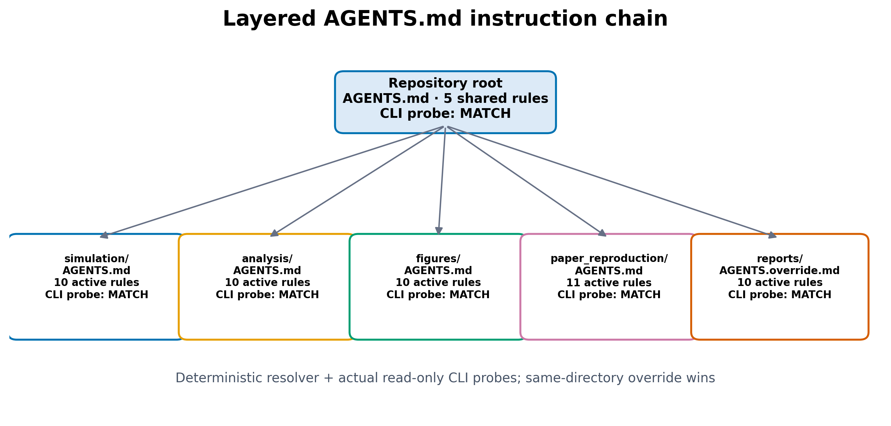
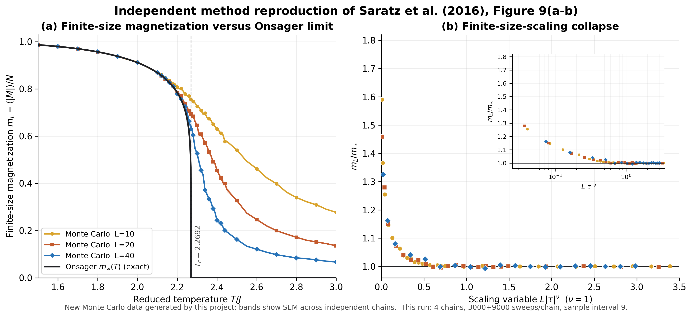
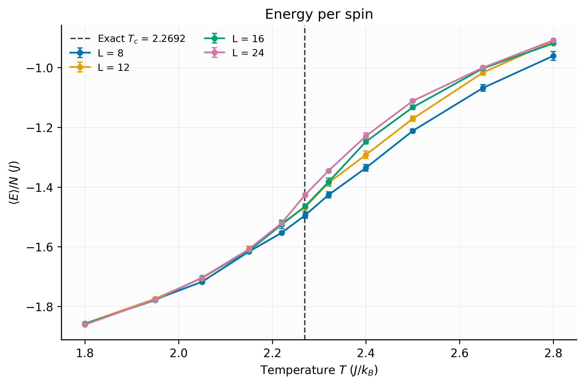
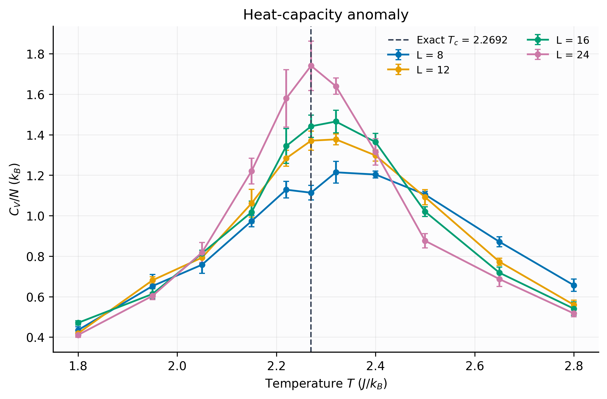
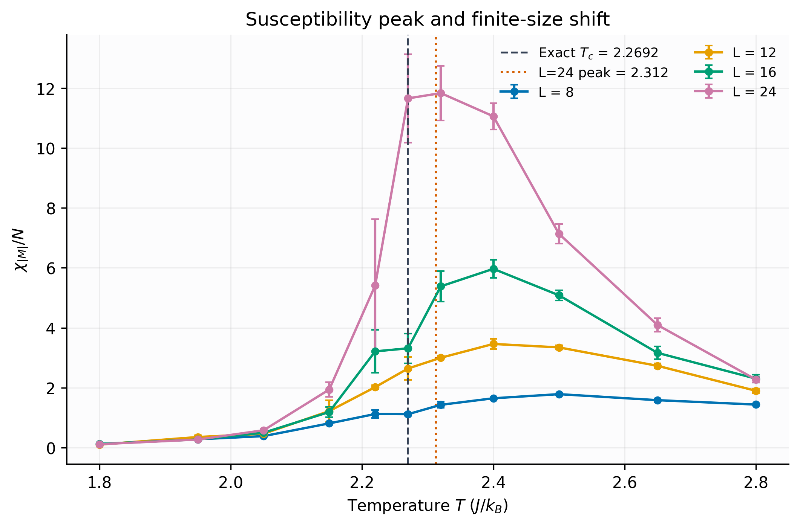
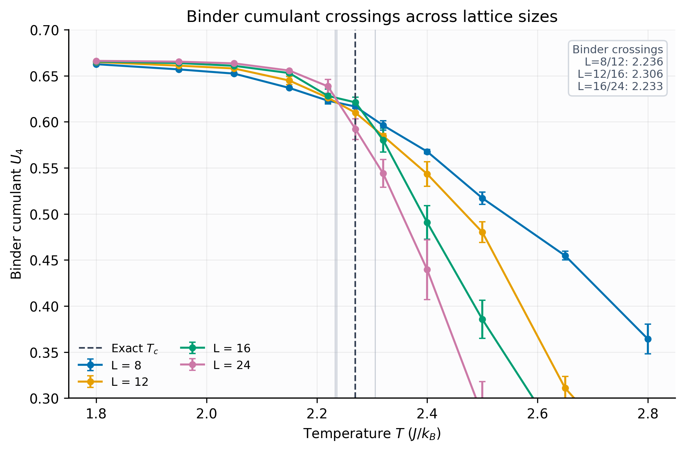
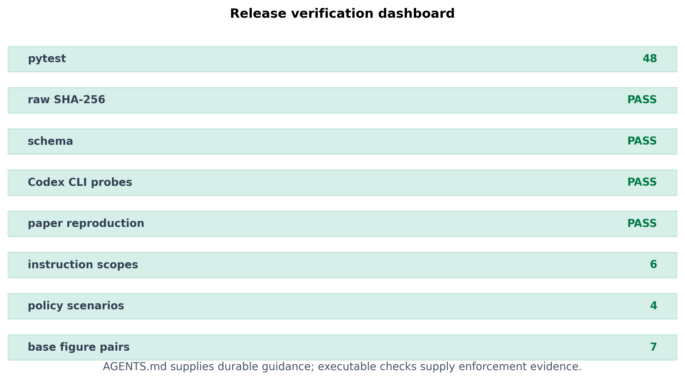

# Codex 科研实战（06）：用分层 AGENTS.md 复现一张 Nature Communications 论文图

> **不是让 Codex 画一张“像论文”的图，而是把论文参数、物理定义、采样协议、统计口径和复现边界写进不同目录的 `AGENTS.md`；随后独立重算 Saratz 等人论文 Figure 9(a–b)，检查二维 Ising 有限尺寸磁化和标度塌缩能否真正出现。**
>
> **Codex 科研实战系列 · 第 06/18 期**

## 写在前面：为什么要给 Coding Agent 一个公开的外部标准

第五期中，我们把一个会分配约 20 GiB 位移张量的全距离矩阵改造成周期性空间索引，并用物理等价性测试和独立进程 Benchmark 验证优化。那个项目已经出现过一个根目录 `AGENTS.md`，但它只是附件中的项目契约，没有系统回答三个更容易踩坑的问题：

1. 一个仓库同时包含模拟、统计分析、作图和报告时，能不能让不同目录继承不同规则？
2. 根目录和子目录规则冲突时，Codex 到底读取哪一份？
3. 写了“禁止修改原始数据”，是否等于文件已经受到保护？

如果只有内部测试，程序很容易形成一个自洽但错误的闭环：代码能跑、图也好看，所有测试甚至都能通过，却没有外部证据说明问题设定与公开研究一致。

所以这次给项目增加一个明确的外部验收目标：N. Saratz 等人在 *Nature Communications* 发表的论文 [“Critical exponents and scaling invariance in the absence of a critical point”](https://doi.org/10.1038/ncomms13611) 中的 Figure 9(a–b)。原图同时包含有限尺寸 Monte Carlo 数据、Onsager 无限体系精确解和有限尺寸标度塌缩，正好可以检查：模型、尺寸、观测量、解析公式与标度变量是否全部对齐。

这篇的实际意义，不是证明二维 Ising 模型有多新，而是演示科研 Coding Agent 如何面对“有公开标准答案”的任务。普通代码教程只要求程序能够运行；论文复现还必须回答：

1. 模型是不是同一个，尺寸、外场和温度范围是否对齐？
2. 零场有限体系的磁化究竟用 `⟨M⟩` 还是 `⟨|M|⟩`？
3. 解析参考线和标度变量有没有写反？
4. 误差条来自相关时间点，还是独立链？
5. 最终结果是论文原始数据、独立重算，还是仅仅外观相似的示意图？

这些问题同样存在于 DFT、分子动力学、谱学拟合和机器学习论文复现中。可迁移的方法是：先把文献条件变成不能静默漂移的项目契约，再让源码、测试、哈希、元数据和结果图共同提供证据。

本期仓库仍保留根级规则、专业子目录规则，以及同目录并存的 `AGENTS.md` / `AGENTS.override.md`；在此基础上新增 `paper_reproduction/AGENTS.md`，专门锁住论文图的参数、公式与声明边界。随后从不同目录启动 Codex CLI，只读探测实际生效的指令标记，并运行两条互补证据链：基础 Ising 热力学验证，以及论文 Figure 9(a–b) 的独立重算。

完整链条如下：

```text
根目录科研契约
      │
      ├── simulation/AGENTS.md：Hamiltonian、PBC、Metropolis、随机种子
      ├── analysis/AGENTS.md：独立链、SEM、Cv、χ、Binder U4
      ├── figures/AGENTS.md：误差棒、禁止平滑造交点、PNG + PDF
      ├── paper_reproduction/AGENTS.md：论文目标、L、T、mL 与 FSS 变量
      └── reports/AGENTS.override.md：报告只能读取已验证结果
                          │
                          ↓
     从 root / simulation / analysis / figures / paper_reproduction / reports 启动探针
                          │
                          ↓
      基础 Monte Carlo → hash snapshot → 热力学量与内部交叉验证
                          ＋
      论文参数 → 732 条独立链 → Onsager 对照 → Figure 9(a–b) 重绘
                          │
                          ↓
         pytest + raw hash + scope audit + 人工检查 Git diff
```

本例采用无量纲二维方格 Ising 模型，设 `k_B=J=1`。所有图中数据均由附件代码实际生成，但它仍是数值模型，不是原论文实验数据，也不用于给出新的高精度临界指数。

> **本次可核验交付状态**
>
> - Codex CLI：`codex-cli 0.171.0-alpha.13`；
> - 环境：Windows 11、Python 3.13.1、NumPy 2.2.2、pandas 2.2.3、Matplotlib 3.10.3、pytest 9.2.0；
> - 自动化测试：`48 passed`；
> - 基础验证：4 个尺寸 × 11 个温度 × 4 条独立链，共 176 条链；
> - 论文复现：`L=10/20/40` × 61 个温度 × 4 条独立链，共 732 条链；
> - 复现链参数：3,000 sweeps 热化、9,000 sweeps 测量、每 9 sweeps 保存一次，每链 1,000 个样本；
> - 原始结果 SHA-256、176 行 schema、再生结果与发布结果字节哈希：全部通过；
> - 六个工作目录的真实只读 Codex CLI 探针：全部与确定性 resolver 一致；
> - 基础验证七组图 + 论文复现一组图，均输出 300 dpi PNG 与矢量 PDF；
> - 论文复现实际耗时：136.23 s；`T/J=3` 时 `mL=0.277135/0.135718/0.066789`（`L=10/20/40`）；
> - `T≤2` 区间相对 Onsager 精确磁化的平均绝对差：`3.61×10⁻⁴`；
> - Binder 交点中位数仍为 `T=2.236106`，只作为内部教学规模交叉验证。

---

# 01｜先讲清楚：AGENTS.md 是什么，不是什么

## 1.1 它适合保存“跨任务仍然成立”的项目约定

一次性任务可以直接写在当前提示词里，例如：“只检查这一个函数为什么返回 NaN”。但下面这些约定不应每次重新复制：

- 原始输入在哪个目录，哪些文件不得手改；
- 物理量的定义、单位和符号约定；
- 修改代码后必须执行哪些测试；
- 图中的误差棒来自什么统计单位；
- 哪些命令高风险或禁止执行；
- 什么证据足以声称任务完成。

`AGENTS.md` 的价值不是让提示词更“高级”，而是把这些持久约定和源码一起版本化，让新会话、新成员和不同任务共享同一份项目上下文。

## 1.2 官方发现规则比“放一个文件在仓库里”更具体

根据当前 OpenAI 官方文档，Codex 在一次运行开始时构建指令链：

1. 在 `CODEX_HOME`（通常是 `~/.codex`）先找全局 `AGENTS.override.md`，没有非空 override 才读全局 `AGENTS.md`；
2. 在项目层，从项目根目录沿路径走到**当前工作目录**；
3. 每一级目录依次检查 `AGENTS.override.md`、`AGENTS.md` 和配置过的 fallback 文件名；
4. 每一级目录最多装入一个文件；
5. 文件按根目录到当前目录拼接，更靠近当前目录的冲突规则后出现，因此更具体；
6. 空文件跳过；项目指令默认预算为 32 KiB，超过 `project_doc_max_bytes` 后停止继续加入；
7. 修改规则后应启动新命令或新会话，不应假设当前 TUI 立即热加载。

这里有两个反直觉结论：

- **从仓库根目录启动，不会无条件装入所有子目录的 `AGENTS.md`。** 发现路径走到当前工作目录就停止。
- **同一目录存在 `AGENTS.override.md` 时，它取代同目录的 `AGENTS.md`，不是与后者叠加。**

## 1.3 它不是权限系统

下面这句话需要写在每一篇严肃教程里：

> `AGENTS.md` 是进入模型上下文的持久指导，不是文件系统 ACL、安全沙箱、Git 分支保护或 CI。

即使规则写着“禁止修改 `data/raw/`”，一个拥有写权限的程序仍能覆盖文件；模型也可能误解、遗漏或在复杂冲突中执行错误。因此本期同时使用：

- read-only sandbox：限制只读探针的命令权限；
- SHA-256：检测原始结果是否变化；
- scope audit：检查变更路径是否越界；
- pytest：把物理公式和统计约定编码为测试；
- Git diff：由人检查实际修改；
- 独立链与已知解析结果：检查科学合理性。

---

# 02｜先读目标图，再写代码

## 2.1 本期复现哪一张论文图

目标文献是：

> N. Saratz et al., “Critical exponents and scaling invariance in the absence of a critical point,” *Nature Communications* **7**, 13611 (2016), DOI: [10.1038/ncomms13611](https://doi.org/10.1038/ncomms13611)。

本期只复现 Figure 9 的两个数值面板：

- Figure 9(a)：无挫折、零外场二维 Ising 模型在 `L=10、20、40` 时的有限尺寸磁化 `mL(T)`，以及无限体系 Onsager 精确解；
- Figure 9(b)：把亚临界数据改写为 `mL/m∞` 对 `L|τ|^ν` 后得到的有限尺寸标度函数。

原论文 Figure 9(c–d) 是 Fe/Cu(001) 薄膜实验数据及畴尺度分析，不属于本期纯 Ising 数值项目，因此不混进复现图。

这两个面板在原论文中不是孤立的“教材插图”，而是一个对照组：作者用普通二维 Ising 有限尺寸标度，检验实验磁畴尺度是否能简单等同于截断关联长度的有限尺寸。我们复现的是这个数值基准，不是整篇论文的实验结论。

论文明确给出与项目自行选择的内容必须分开：

| 类别 | 内容 |
|---|---|
| 论文明确给出 | 无挫折二维方格 Ising、零外场、`L=10/20/40`、图示范围 `T/J=1.5–3.0`、Onsager 曲线、`ν=1` 的 FSS 关系 |
| 本项目明确选择 | 周期边界、红黑 Metropolis、61 点温度网格、4 条链、热化/测量长度、抽样间隔、根种子和链间 SEM |
| 论文未为该图完整公开 | Figure 9(a–b) 的随机种子、逐温度采样预算、误差估计流程，以及有限体系 `mL` 的操作性估计量 |

因此，本期属于**独立数值复现**，不是论文原始数据逐点复刻。有限体系零场有 `Z₂` 翻转；若直接长时间平均有符号 `M`，结果会趋近零。本项目明确采用：

```text
mL = ⟨|M|⟩ / L²
```

无限体系精确参考与标度变量为：

```text
Tc = 2 / ln(1 + sqrt(2)) = 2.269185314...

m∞(T) = [1 - sinh(2/T)^(-4)]^(1/8),  T < Tc
m∞(T) = 0,                            T ≥ Tc

τ = (T - Tc) / Tc
ξ ∝ |τ|^(-ν)
x = L/ξ ∝ L|τ|^ν
ν = 1
```

这里有两个必须测试而不是凭记忆处理的细节：横轴是乘法 `L|τ|^ν`，不是 `L/|τ|^ν`；`mL/m∞` 只在 `T<Tc` 时有定义，因为 `T≥Tc` 的无限体系 `m∞=0`。

## 2.2 二维方格 Ising 模型

每个格点有一个自旋：`sᵢ ∈ {−1,+1}`。

零外场、最近邻耦合的 Hamiltonian 为：

```text
H = −J Σ⟨i,j⟩ sᵢsⱼ
```

本例设 `J=1`、`k_B=1`，并采用二维周期性边界。一个 `L×L` 方格共有 `N=L²` 个自旋和 `2N` 条无向最近邻键，因此全同向基态必须满足：

```text
E₀ = −2JN
E₀/N = −2J
```

这不是“看起来合理”的参考值，而是可以直接编码进测试的解析不变量。

## 2.3 单自旋翻转和 checkerboard Metropolis

翻转格点 `i` 的能量差为：

```text
ΔEᵢ = 2J sᵢ Σⱼ∈nn(i) sⱼ
```

在四配位方格晶格中，`ΔE/J` 只能取：

```text
-8, -4, 0, 4, 8
```

Metropolis 接受规则为：

```text
Pacc = min[1, exp(−βΔE)]
β = 1/T
```

项目采用红黑 checkerboard 更新：同一子晶格的自旋没有彼此相邻，可以向量化计算；但完成一个子晶格后，必须重新计算邻居场再更新另一个子晶格。由于周期边界下奇数 `L` 会破坏这种二分，代码显式拒绝奇数尺寸。

核心更新逻辑如下，完整实现见附件：

```python
def metropolis_sweep(spins, beta, rng):
    if spins.shape[0] < 4 or spins.shape[0] % 2:
        raise ValueError("red-black periodic updates require even L >= 4")
    ii, jj = np.indices(spins.shape)
    for parity in (0, 1):
        neighbor_sum = (
            np.roll(spins, 1, axis=0)
            + np.roll(spins, -1, axis=0)
            + np.roll(spins, 1, axis=1)
            + np.roll(spins, -1, axis=1)
        )
        delta_e = 2 * spins * neighbor_sum
        mask = (ii + jj) % 2 == parity
        accept = mask & (
            (delta_e <= 0)
            | (rng.random(spins.shape) < np.exp(-beta * np.maximum(delta_e, 0)))
        )
        spins[accept] *= -1
```

总能量只沿两个正方向计数，每条无向键恰好出现一次：

```python
def total_energy(spins):
    return -np.sum(
        spins
        * (
            np.roll(spins, -1, axis=0)
            + np.roll(spins, -1, axis=1)
        )
    )
```

## 2.4 本期计算的热力学量

令 `e=E/N`、`m=M/N`，每条独立链在生产段先计算矩，再得到：

```text
Cv/N      = β²N [⟨e²⟩ − ⟨e⟩²]
χ|m|/N    = βN  [⟨m²⟩ − ⟨|m|⟩²]
U4        = 1 − ⟨m⁴⟩ / [3⟨m²⟩²]
```

这里使用的是基于绝对磁化的有限尺寸磁化率估计量 `χ_|m|/N`，不是把它不加说明地当成严格零场磁化率。Binder cumulant 必须先对 `m²`、`m⁴` 求期望，再做非线性组合，不能逐样本计算 `U4` 后平均。

每个 `(L,T)` 使用 4 条不同子种子的独立链。程序先在每条链上得到上述观测量，再以链为统计单位计算：

```text
SEM = s_chain / sqrt(n_chain)
```

其中样本标准差采用 `ddof=1`。相关的 Monte Carlo 时间点不能被伪装成数千个独立重复。

---

# 03｜把科学契约拆到对应目录，而不是堆进一个超长文件

## 3.1 项目结构

```text
Codex_Research_Tutorial_06/
├── AGENTS.md
├── simulation/
│   ├── AGENTS.md
│   └── core.py
├── analysis/
│   ├── AGENTS.md
│   └── observables.py
├── figures/
│   └── AGENTS.md
├── paper_reproduction/
│   ├── AGENTS.md
│   ├── run_figure9_reproduction.py
│   └── results/
├── reports/
│   ├── AGENTS.md
│   └── AGENTS.override.md
├── data/
│   ├── raw/ising_chain_summary.csv
│   └── raw_manifest.json
├── schemas/instruction_probe.schema.json
├── scripts/
├── tests/
├── results/
├── make_figures.py
├── run_experiment.py
├── START_HERE.md
└── VERIFICATION_RESULTS.md
```

完整目录、命令和生成物见附件中的 `START_HERE.md` 与 `VERIFICATION_RESULTS.md`；压缩包排除了虚拟环境和缓存。

## 3.2 根目录只放全仓库都成立的约定

根级 `AGENTS.md` 把每条规则写成可探测 ID，其职责是：

```markdown
- [ROOT-DATA-01] `data/raw/` 是冻结的发布快照，再生表写入 `results/reproduction/`。
- [ROOT-PROVENANCE-02] 所有机器可读派生结果保留 synthetic_monte_carlo 与种子元数据。
- [ROOT-SCOPE-03] 修改保持在最小相关子树，不访问仓库外文件或凭据。
- [ROOT-VERIFY-04] Python 修改后运行 pytest；发布前运行完整验证脚本。
- [ROOT-EVIDENCE-05] 区分 Monte Carlo 测量、解析公式与解释。
```

根文件不应该塞入 Binder 公式、绘图线宽或每一个函数名。这些细节对整个仓库并非都适用，而且会消耗所有任务的上下文。

## 3.3 模拟层保存 Hamiltonian 和更新算法不变量

`simulation/AGENTS.md` 使用 `SIM-*` 规则标记，明确 Hamiltonian、周期边界、种子、采样阶段、输出目录与验证命令；模拟代码和测试再把下列不变量机械化：

- `H=-JΣs_i s_j`，`k_B=J=1`；
- 周期边界和能量键只计一次；
- `ΔE=2Js_iΣ_nn s_j`；
- checkerboard 只接受偶数 `L`；
- 生产链使用派生但不重复的子种子；
- 改动后运行模拟核心测试和小型确定性回归。

## 3.4 分析层保存“误差究竟来自谁”

`analysis/AGENTS.md` 使用 `ANALYSIS-*` 规则标记，明确观测量、公式、链级 SEM、Tc 估计器和验证命令；代码与测试进一步检查：

- 链是 SEM 的独立统计单位；
- `Cv`、`χ_|m|` 和 `U4` 的精确定义；
- 分母保护和至少两条链要求；
- Binder 交点只能在相邻温度差值变号区间线性插值；
- 不允许用高阶平滑或区间外外推制造交点。

## 3.5 绘图层保存证据表达约定

`figures/AGENTS.md` 使用 `FIG-*` 规则标记，包括：

- 误差棒必须来自链间 SEM；
- 坐标、图例和单位必须写清；
- 每张主图同时导出 300 dpi PNG 与 PDF；
- 作图代码只能读取已提交结果表，不能在绘图阶段重跑链；
- 理论参考线、确定性示意图和实际模拟结果必须在图注中区分。

## 3.6 同目录 override 实验

`reports/` 故意同时放置：

```text
reports/AGENTS.md           → REPORT-BASE-IGNORED
reports/AGENTS.override.md  → REPORT-SOURCE-01 ... REPORT-VERIFY-05
```

如果发现机制正确，从 `reports/` 启动的新运行应看到五条 `ROOT-*` 和五条 override 规则，不应看到 `REPORT-BASE-IGNORED`。这是一项比“我觉得 override 优先”更可检查的实验。

## 3.7 论文复现层只保存文献特有约束

`paper_reproduction/AGENTS.md` 不重复根目录的全部规则，而是增加六条只对这张论文图成立的约束：

```markdown
- [PAPER-TARGET-01] 目标固定为 Saratz et al. Figure 9(a-b)。
- [PAPER-PARAM-02] 固定模型、零外场、J=kB=1、L=10/20/40 与 T/J=1.5...3.0。
- [PAPER-DISCLOSURE-03] 只能称独立方法复现，不得冒充原始数据逐点复刻。
- [PAPER-SAMPLING-04] 保存所有自选采样参数、种子、链数和间隔。
- [PAPER-STATISTICS-05] 先算链级非线性量，再计算链间 SEM。
- [PAPER-FIGURE-06] 重新计算并重绘，不复制论文像素；同时导出 PNG 和 PDF。
```

代码和测试再补上两条不能只靠文字保证的不变量：Figure 9(b) 只筛选 `T<Tc`；横轴必须计算为 `L|τ|^ν`。这样，根规则负责数据与验证，模拟规则负责 Hamiltonian 与 PBC，分析规则负责统计口径，论文复现规则负责外部目标。

---

# 04｜不要猜：从六个工作目录实际运行 Codex 指令探针

## 4.1 只读探针命令

先检查本机参数：

```powershell
codex --version
codex exec --help
```

本机实际支持 `-C/--cd`、`--sandbox read-only` 和 `--ephemeral` 后，再执行：

```powershell
codex exec -C . `
  --sandbox read-only `
  --ephemeral `
  --skip-git-repo-check `
  --output-schema schemas/instruction_probe.schema.json `
  -o results/codex_instruction_probes/root.json `
  "只返回当前生效的仓库 AGENTS 唯一标记。不要运行命令，不要修改文件。"

codex exec -C .\simulation `
  --sandbox read-only `
  --ephemeral `
  --skip-git-repo-check `
  --output-schema schemas/instruction_probe.schema.json `
  -o results/codex_instruction_probes/simulation.json `
  "只返回当前生效的仓库 AGENTS 唯一标记。不要运行命令，不要修改文件。"
```

`analysis/`、`figures/`、`paper_reproduction/`、`reports/` 使用同一模式。`--sandbox read-only` 是实际权限边界；提示词中的“不要修改”只是额外意图说明。这里使用 `--skip-git-repo-check`，因为本次教学目录位于另一个大仓库内部且未单独设为受信任仓库；在正常 Git 项目或已信任项目中应按本机设置决定是否需要该参数。

## 4.2 实际装载矩阵

| 启动目录 | 实际读取的规则 | 规则数 | 与确定性 resolver 一致 |
|---|---|---:|---:|
| 根目录 | `ROOT-*` | 5 | 是 |
| `simulation/` | `ROOT-*` + `SIM-*` | 10 | 是 |
| `analysis/` | `ROOT-*` + `ANALYSIS-*` | 10 | 是 |
| `figures/` | `ROOT-*` + `FIG-*` | 10 | 是 |
| `paper_reproduction/` | `ROOT-*` + `PAPER-*` | 11 | 是 |
| `reports/` | `ROOT-*` + override 中的 `REPORT-*` | 10 | 是 |

`paper_reproduction` 的真实 JSON 包含 5 条根规则和 6 条论文复现规则；`reports` 的实际 JSON 中 `base_report_rule_loaded=false`，因此同目录的 `REPORT-BASE-IGNORED` 没有进入活动指令。六次探针均来自 `codex-cli 0.171.0-alpha.13` 的新临时会话。

这组结果应验证四个性质：

1. 根目录启动只装入根级项目规则，不会扫描并装入所有子目录规则；
2. 子目录启动保留根级通用规则，并追加本目录专业规则；
3. 论文复现目录确实装入 `PAPER-*`，不是正文声称有规则但 CLI 没有读取；
4. `reports/` 同目录只装入 override，不装入 sibling `AGENTS.md`。

图 1 同时读取这些实际 JSON 和确定性 resolver 的结果，在每个目录框中标出 `CLI probe: MATCH`。resolver 可以检查目录结构，但不能替代 Codex 的实际探针。

---

# 05｜先用解析不变量和单元测试锁住物理，再跑正式模拟

## 5.1 测试不是只检查“程序没有报错”

本项目的测试至少覆盖：

1. `L=4` 全同向构型满足 `E/N=-2`；
2. 基态翻转一个自旋时 `ΔE=8`；
3. 随机构型中，局部 `ΔE` 等于翻转前后直接重算总能量之差；
4. 周期循环平移不改变能量；
5. 奇数 `L` 被 checkerboard 更新显式拒绝；
6. 所有局部 `ΔE` 只属于 `{-8,-4,0,4,8}`；
7. 相同种子产生完全一致的短链；
8. 不同链的派生子种子不重复；
9. `Cv`、`χ_|m|`、`U4` 与小数组手算一致；
10. SEM 使用链级结果和 `ddof=1`；
11. Binder crossing 不允许区间外外推；
12. 根级、嵌套和 override 解析顺序；
13. 分析与作图后 raw SHA-256 不变；
14. 原始快照哈希变更能够被检测；
15. 低温磁化高于高温等宽松物理回归。
16. Onsager 自发磁化在 `T<Tc` 为正、在 `T≥Tc` 严格为零；
17. Figure 9(b) 的标度横轴等于 `L|τ|^ν`，且零分母点不会进入比值图；
18. 论文复现链的种子唯一、`mL` 归一化和链间 SEM 计算正确。

七组 PNG/PDF 的数量、文件大小和配对关系由发布验证脚本单独检查，不与纯单元测试混为一谈。

正式运行前执行：

```powershell
python -m pytest -q
```

本机实际结果：

```text
................................................                         [100%]
48 passed in 3.83s
```

测试通过只说明已经编码的约束成立，不说明热化偏差、有限尺寸效应和采样误差已经消失。

## 5.2 三种参数档位

为避免读者第一次运行就等待正式网格，基础模拟提供 smoke 与 production 两档，另有独立的论文复现档：

```text
smoke:
L = 8, 12
T = 2.00, 2.27, 2.60
2 chains; 40 equilibration sweeps; 80 measurement sweeps; interval = 4

production:
L = 8, 12, 16, 24
T = 1.80, 1.95, 2.05, 2.15, 2.22, 2.27, 2.32, 2.40, 2.50, 2.65, 2.80
4 chains; 600 equilibration sweeps; 1,200 measurement sweeps; interval = 4

paper reproduction:
L = 10, 20, 40
T/J = 1.50...3.00; 61 points, with 0.01 spacing around Tc and extra 2.265/2.268
4 chains; 3,000 equilibration sweeps; 9,000 measurement sweeps; interval = 9
```

每个 `(L,T)` 的链种子由固定的根 `SeedSequence` 派生，并写入原始结果。burn-in、生产长度和 `sample_every` 在运行前由配置固定，不能看完曲线再随意移动热化终点。

## 5.3 生成、冻结和验证原始链结果

```powershell
python run_experiment.py
python analysis/run_analysis.py
python make_figures.py
python scripts/snapshot_raw.py verify
python scripts/run_verification.py
```

运行顺序很重要：再生模拟默认写入 `results/reproduction/`，不会覆盖 `data/raw/` 的发布快照；分析和绘图阶段只读取已冻结结果。修改后最终源码的 176 链完整重跑耗时 105.57 s，本机得到的再生 CSV 与发布 CSV 的 SHA-256 完全一致。最终校验为：

```text
raw hash: PASS
schema: PASS
reproduction_matches_release_sha256: true
ising_chain_summary.csv:
5a962c4a33163a3e88dd87e61935a6b5144ad193110a51d769c97dce91a0e89f
```

## 5.4 独立运行论文复现，不覆盖基础发布快照

论文复现有独立入口与结果目录：

```powershell
python paper_reproduction/run_figure9_reproduction.py --quick
python paper_reproduction/run_figure9_reproduction.py
```

正式运行生成 732 行链级结果、183 行 `(L,T)` 汇总结果、JSON 元数据以及 PNG/PDF。最终源码重跑耗时 136.23 s；源码、链级 CSV、汇总 CSV 和两种图文件的 SHA-256 均写入元数据。`--quick` 只检查管线连通性，输出到单独目录，不作为科学结果发布。

这条证据链没有从论文图片反推数值点，也没有下载作者原始数据。它只使用论文明确给出的物理目标，再以本项目公开的采样协议独立计算。

---

# 06｜先回答论文复现是否成立，再看内部验证

## 6.1 图 1：规则到底在哪里生效



*图 1｜确定性 resolver 与六次实际 Codex CLI 只读探针的对照。每个目录都显示 `CLI probe: MATCH`；论文复现目录实际装入 11 条规则，`reports/AGENTS.md` 因同目录 override 存在而未装入。该图不是 Codex 界面截图。*

## 6.2 图 2：能否独立复现 Saratz et al. Figure 9(a–b)



*图 2｜对 Saratz et al. Figure 9(a–b) 的独立数值复现。左图为 `L=10、20、40` 时重新计算的 `mL=⟨|M|⟩/L²`，黑线为 Onsager 无限体系精确解，阴影为 4 条独立链之间的 SEM；右图只使用 `T<Tc` 的数据，绘制 `mL/m∞` 对 `L|τ|^ν`，其中 `ν=1`。数据由本项目独立生成，并非论文原始数据。*

这里不以“长得像”为通过标准，而检查四个预先声明的性质：

1. 低温区三个尺寸都应接近 Onsager 曲线；
2. 临界区偏离最大，过渡随有限尺寸被圆滑；
3. `Tc` 以上的 `⟨|M|⟩` 不会严格为零，但应随 `L` 增大而下降；
4. 亚临界数据改写为 `mL/m∞` 对 `L|τ|^ν` 后，不同 `L` 应落到共同趋势附近。

正式结果满足这些检查。`T≤2` 区域相对 Onsager 曲线的平均绝对差为：

```text
mean |mL - m∞| = 0.000360751
```

在 `T/J=3`，三个有限体系仍有正的绝对磁化尾部，但随尺寸增大快速降低：

```text
L=10: mL = 0.277135 ± 0.001484
L=20: mL = 0.135718 ± 0.000955
L=40: mL = 0.066789 ± 0.001638
```

这与原论文图中约 `0.27 / 0.13 / 0.06` 的视觉读数及尺寸次序一致。不过，视觉读数不是作者原始数值，因此只作为形状核对，不用于宣称逐点相等。

原来的 4 尺寸粗网格磁化图仍保留为附件补充图 S1；正文用论文参数图取代它，因为后者具有公开的外部目标。

## 6.3 图 3：能量曲线能否给出一致的有序—无序趋势



*图 3｜`⟨E⟩/N` 随温度升高而上升。不同尺寸在低温区接近，而临界区出现更明显的有限尺寸差异。该图来自发布 CSV 的实际链矩，不是解析曲线。*

## 6.4 图 4：热容异常如何随尺寸增强



*图 4｜由每条链的能量一、二阶矩计算 `Cv/N`，再对链级结果求均值与 SEM。`L=24` 在采样温度网格中出现更高、更尖的峰，但有限网格与相关采样意味着它不是高精度临界指数测量。*

## 6.5 图 5：有限尺寸磁化率峰为什么不等于精确 Tc



*图 5｜基于绝对磁化的有限尺寸估计量 `χ|M|/N`。最大尺寸 `L=24` 的局部二次峰位为 `T=2.312318`，高于精确参考 `2.269185`；这正体现了有限尺寸、离散温度网格与估计量定义带来的偏移。局部二次插值只在峰值相邻三个实际温度点内使用。*

## 6.6 图 6：Binder 交点如何给出另一种 Tc 估计



*图 6｜多个 `L` 的 Binder cumulant 离散点、链间 SEM、预先规定窗口内的相邻点线性交叉估计，以及 Onsager 精确参考值。没有使用高阶平滑或区间外外推。*

实际得到：

```text
L=8/12   crossing = 2.236106
L=12/16  crossing = 2.305727
L=16/24  crossing = 2.233151
median Binder crossing = 2.236106
exact infinite-lattice reference = 2.269185
```

可接受的结论是：**教学规模模拟的有限尺寸交点位于精确参考值附近，并且不同尺寸对仍有清楚离散。** 不可接受的结论是“Codex 精确复现了临界点”。

## 6.7 图 7：发布证据是否完整



*图 7｜基础发布验证汇总：48 项 pytest、raw SHA-256、结果 schema、六个 Codex CLI 探针、六种指令作用域、四个路径策略场景和七组基础图。论文复现主图另有独立 CSV、元数据与文件哈希。它证明这些已编码检查通过，不证明所有科学系统误差都已消失。*

---

# 07｜越界修改实验：文字规则必须接上机械护栏

## 7.1 一个看似“让测试变绿”的危险要求

假设某项回归测试要求低温 `|m|` 足够高，但短链因热化不足而失败。最危险的修复不是语法错误，而是直接修改原始 CSV/NPZ，或者在分析代码中筛掉不利链。

根级 `AGENTS.md` 已说明原始结果只读，但我们仍然不把安全寄托在一句话上。项目提供 scope auditor：

```powershell
python scripts/build_audits.py
```

实际输出：

```text
allowed scenario:
safe_analysis_patch
scope = analysis
changed = analysis/observables.py; tests/test_analysis.py
passed = True

forbidden scenario:
raw_snapshot_tamper
scope = simulation
changed = data/raw/ising_chain_summary.csv
passed = False
finding = PROTECTED_INPUT
```

另一个 `report_scope_escape` 场景尝试从报告作用域修改 `analysis/observables.py`，也被机械审计以 `REPORTS_SCOPE` 拒绝。这里审计的是**声明或 Git diff 中出现的路径**；它不能自行判断一行代码的科学含义。

## 7.2 三层证据回答不同问题

| 机制 | 回答的问题 | 不能证明什么 |
|---|---|---|
| `AGENTS.md` | Codex 启动时应知道哪些项目约定 | 不能阻止有写权限的进程改文件 |
| read-only sandbox | 本次探针是否拥有写权限 | 不能验证科学公式正确 |
| SHA-256 | 原始字节是否发生变化 | 不能证明数据本身可信 |
| scope audit / Git diff | 修改路径是否在允许范围 | 不能判断每一行科学意义 |
| pytest | 已编码的不变量是否满足 | 不能覆盖未编码假设和系统误差 |
| 独立链与解析参考 | 实现和统计是否基本自洽 | 不能替代更长采样和独立复现 |

因此，“写好 AGENTS.md”不是项目终点，而是把正确验证入口稳定地提供给 Codex。

---

# 08｜给 Codex 的任务应该怎么写

## 8.1 先检查规则装载，不改文件

当子目录规则很关键时，先在目标目录启动一个新命令：

```text
你当前位于 analysis/。

只读检查当前生效的 AGENTS 指令：
1. 列出你看到的唯一规则标记；
2. 复述 Binder U4、Cv/N、χ_|m|/N 的定义；
3. 说明 SEM 的统计单位；
4. 列出完成修改前必须执行的验证命令。

不要修改文件，不要运行模拟。
```

这不是让模型背诵提示词，而是在高代价任务开始前确认工作目录和专业契约没有选错。

## 8.2 一个有边界的论文复现任务

```text
目标：检查并修正 paper_reproduction/ 中 Figure 9(b) 的标度变量与筛选范围。

允许修改：
- paper_reproduction/run_figure9_reproduction.py
- paper_reproduction/test_figure9_reproduction.py

禁止修改：
- data/raw/**
- simulation/**
- figures/**
- 任何 AGENTS.md / AGENTS.override.md

要求：
- 根据 ξ∝|τ|^(-ν)，横轴必须是 L|τ|^ν；
- mL/m∞ 只能使用 T<Tc 且 m∞>0 的数据；
- 不得读取或数字化论文位图来替换独立计算结果；
- 增加标度变量手算测试、Tc 过滤测试和 Onsager 分段测试；
- 运行复现子树测试、完整 pytest、raw hash verify 和正式复现；
- 最后报告实际命令、退出码、修改文件和剩余局限。
```

这里的提示词仍然写明本次目标与允许范围，因为 `AGENTS.md` 不应承载一次性需求。持久规则和当前任务相互补充，不是二选一。

## 8.3 哪些内容不适合继续塞进 AGENTS.md

- 只对这一次 PR 有效的临时任务；
- 可以从源码和测试直接推断的琐碎实现细节；
- 数百行背景论文摘录；
- 账号、API key、集群密码或未公开敏感数据；
- 无法通过命令或人工检查验证的“写得高级一点”；
- 所有工具的通用教程。

如果文件越来越长，应将专门流程拆到版本化文档或可复用 skill，并让 `AGENTS.md` 保留最小、准确、经常生效的入口。

---

# 09｜从头复现

## 9.1 安装

```powershell
py -m venv .venv
.\.venv\Scripts\python.exe -m pip install --upgrade pip
.\.venv\Scripts\python.exe -m pip install -r requirements.txt
```

## 9.2 快速验证

```powershell
.\.venv\Scripts\python.exe -m pytest -q
.\.venv\Scripts\python.exe run_experiment.py --quick
.\.venv\Scripts\python.exe analysis/run_analysis.py
.\.venv\Scripts\python.exe scripts/build_audits.py
.\.venv\Scripts\python.exe scripts/summarize_codex_probes.py
.\.venv\Scripts\python.exe make_figures.py
.\.venv\Scripts\python.exe scripts/snapshot_raw.py verify
.\.venv\Scripts\python.exe scripts/run_verification.py
.\.venv\Scripts\python.exe paper_reproduction/run_figure9_reproduction.py --quick
```

基础模拟的 `--quick` 默认写入 `results/smoke/`；论文复现的 `--quick` 写入 `paper_reproduction/results/quick/`。两者都不会覆盖完整再生表或 `data/raw/`。

## 9.3 正式基础结果

```powershell
.\.venv\Scripts\python.exe run_experiment.py
.\.venv\Scripts\python.exe analysis/run_analysis.py
.\.venv\Scripts\python.exe make_figures.py
.\.venv\Scripts\python.exe scripts/snapshot_raw.py verify
.\.venv\Scripts\python.exe -m pytest -q
.\.venv\Scripts\python.exe scripts/run_verification.py
```

完整再生默认写入 `results/reproduction/ising_chain_summary.csv`。本期附件中的实际入口与 `START_HERE.md` 一致。

## 9.4 正式论文复现

```powershell
.\.venv\Scripts\python.exe paper_reproduction/run_figure9_reproduction.py
.\.venv\Scripts\python.exe -m pytest -q
```

正式输出位于：

```text
paper_reproduction/results/reproduction/figure9_chain_summary.csv
paper_reproduction/results/reproduction/figure9_summary.csv
paper_reproduction/results/reproduction/figure9_metadata.json
paper_reproduction/results/figures/fig08_saratz_figure9ab_reproduction.png
paper_reproduction/results/figures/fig08_saratz_figure9ab_reproduction.pdf
```

完整运行需要 Numba 加速，`requirements.txt` 已包含对应依赖。机器性能不同会改变墙钟时间，不应改变固定种子下保存的结果。

---

# 10｜本期结果的边界

这套项目证明了以下事情：

- 根级和子目录 `AGENTS.md` 可以把不同专业约定放入对应工作目录的新 Codex 运行；
- 当前 CLI 探针的实际结果与官方发现顺序相符；
- 同目录 override 的确取代 sibling `AGENTS.md`；
- Ising 更新通过了解析能量、局部 `ΔE`、PBC、种子和统计公式测试；
- 原始链结果在分析和作图前后保持相同 SHA-256；
- Saratz et al. Figure 9(a–b) 的尺寸次序、Onsager 低温极限和 FSS 共同趋势可以由独立计算重现；
- 七张基础图和一张论文复现图均来自附件代码的实际运行。

它没有证明：

- `AGENTS.md` 永远不会被模型误解；
- 所有潜在科学错误都已被测试覆盖；
- 教学规模链已经消除临界慢化和有限尺寸偏差；
- Binder 交点给出了高精度临界温度；
- 本项目恢复了论文未公开的随机种子、采样步数或原始数值；
- 当前曲线与论文每一个像素或数据点完全相同；
- 指令文件可以替代文件权限、Git、CI、人工审查或外部独立复现。

特别是链间 SEM 只刻画当前独立链均值的离散程度，不包含 burn-in 选择、有限尺寸、温度网格和算法自相关造成的全部系统误差。正式复现从同向有序构型开始，并使用局部 Metropolis；临界慢化仍是已知局限，不能因为误差带较窄就忽略。

---

# 11｜本期总结

这一期真正增加的，不是另一张 Ising 曲线，而是一个公开的外部验收标准。没有论文目标时，代码只要内部自洽就可能显得“正确”；加入 Figure 9(a–b) 后，尺寸、温度、磁化定义、精确解和标度变量都必须接受公开文献约束。

五条可迁移的原则是：

1. **先把文献条件写成可检查契约。** 同时标明论文已说明什么、项目自行选择了什么。
2. **按当前工作目录验证装载链。** 不要假设从根启动会读取所有子目录规则。
3. **把冲突做成可测试实验。** 唯一标记和同目录 override 比口头理解更可靠。
4. **科学约定尽量变成测试。** 基态能量、`ΔE`、PBC、统计单位都可以机械检查。
5. **指导与强制分层。** `AGENTS.md` 告诉 Codex 怎样做，sandbox、hash、Git、pytest 和 CI 检查它实际做了什么。

一个科研 Coding Agent 的成熟标志，不是一次生成很多代码，而是能够清楚区分：论文已经说明了什么、项目自行选择了什么、程序实际算出了什么，以及当前证据仍然不能证明什么。

下一期将进入 Jupyter Notebook：不仅修复散落的单元格，还要验证执行顺序、隐藏状态、数据依赖和从干净 kernel 全量重跑。

---

# 配套源码与附件

- [从这里开始](START_HERE.md)
- [本机验证记录](VERIFICATION_RESULTS.md)
- [下载完整项目 ZIP](downloads/Codex_Tutorial_06_Complete_Project.zip)
- [ZIP SHA-256](downloads/Codex_Tutorial_06_Complete_Project.zip.sha256)

## 图号与文件

| 图号 | 文件 | 性质 |
|---|---|---|
| 图 1 | `results/figures/fig01_instruction_hierarchy.png/.pdf` | CLI 探针结果 + 确定性规则树 |
| 图 2 | `paper_reproduction/results/figures/fig08_saratz_figure9ab_reproduction.png/.pdf` | 独立论文复现 + Onsager 解析参考 |
| 图 3 | `results/figures/fig03_energy.png/.pdf` | 实际链均值与 SEM |
| 图 4 | `results/figures/fig04_heat_capacity.png/.pdf` | 实际链级响应函数 |
| 图 5 | `results/figures/fig05_susceptibility.png/.pdf` | 实际链级响应函数 + 局部峰位插值 |
| 图 6 | `results/figures/fig06_binder_crossings.png/.pdf` | 实际 Binder 数据 + 解析参考线 |
| 图 7 | `results/figures/fig07_verification_dashboard.png/.pdf` | 发布检查汇总 |
| 补充图 S1 | `results/figures/fig02_magnetization.png/.pdf` | 基础 4 尺寸粗温度网格磁化 |

论文复现的链级 CSV、汇总 CSV、参数/哈希元数据和运行说明全部位于 `paper_reproduction/`，不是只附一张脱离数据的图片。

---

# 参考资料与致谢

1. OpenAI, [Custom instructions with AGENTS.md](https://learn.chatgpt.com/docs/agent-configuration/agents-md).
2. OpenAI, [Advanced Configuration: Project instructions discovery](https://learn.chatgpt.com/docs/config-file/config-advanced#project-instructions-discovery).
3. OpenAI Cookbook, [Iterating Development Workflows with Codex](https://developers.openai.com/cookbook/examples/codex/iterating-development-workflows-with-codex).
4. Bartosz Naskrecki, [Codex for Research Workflows](https://bnaskrecki.faculty.wmi.amu.edu.pl/workshop_gpt/).
5. N. Metropolis et al., “Equation of State Calculations by Fast Computing Machines,” *J. Chem. Phys.* **21**, 1087–1092 (1953), [DOI: 10.1063/1.1699114](https://doi.org/10.1063/1.1699114).
6. L. Onsager, “Crystal Statistics. I. A Two-Dimensional Model with an Order-Disorder Transition,” *Phys. Rev.* **65**, 117–149 (1944), [DOI: 10.1103/PhysRev.65.117](https://doi.org/10.1103/PhysRev.65.117).
7. K. Binder, “Finite size scaling analysis of Ising model block distribution functions,” *Z. Phys. B* **43**, 119–140 (1981), [DOI: 10.1007/BF01293604](https://doi.org/10.1007/BF01293604).
8. N. Saratz, D. A. Zanin, U. Ramsperger, S. A. Cannas, D. Pescia, and A. Vindigni, “Critical exponents and scaling invariance in the absence of a critical point,” *Nature Communications* **7**, 13611 (2016), [DOI: 10.1038/ncomms13611](https://doi.org/10.1038/ncomms13611). 原文为 CC BY 4.0；本教程没有复制其图像像素或原始数值，而是将 Figure 9(a–b) 作为独立计算目标。

本文只提炼工作流与方法。代码、数据和重绘图均由本教程项目独立生成；引用文献不表示已取得或复制其未公开原始数据。

---

**Codex 科研实战｜第 06 期 完**
